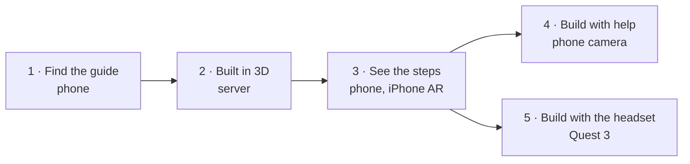

# Jarvis Assembler

Point your phone at a flat-pack box. An agent finds the assembly guide and rebuilds it as an animated 3D model. Then it guides you through the real build, on your phone or in a Meta Quest 3: it shows where each part goes, checks what you are holding, and speaks in Greek or English.

Built at the Gen AI Summit Hackathon, Athens, 14–15 Nov 2026. Try it: <https://agj.boxd.sh>

Status on Sun 15 Nov, 14:55: the demo runs on the native Android app, `quest-android/` (Kotlin, Meta Spatial SDK); `quest-unity/` (Unity 6.3, Meta XR SDK) is the backup. The demo guide is `drawer`, built today for the team's own drawer from tape measurements and phone photos (6 steps, 17 actions). Nothing is printed or stuck on the furniture. On a Quest 3 the app finds each board on the floor by its measured size, locks the guide onto the real drawer front with an on-device detector (median size error 5 to 6 mm on trusted frames), reads which way round the front lies from its groove, and moved through four cam bolts and a side panel without a button press. Not proven on real frames: a part the wrong way round, a wrong small part; steps 4 to 6 of the guide have not run on the headset. The WebXR page (`?mode=xr`) is a desktop preview, not the demo path. What is logged and what is not: [docs/SUBMISSION.md](docs/SUBMISSION.md).

## The flow



| # | What the person does | Technology | Vendor |
|---|---|---|---|
| 1 | **Find the guide.** Scan the code on the box, photograph the box, type its name, or upload the PDF or photos of its pages. | Web app (Vite, TypeScript, jsQR). `gemini-4-hydrogen` recognises the product from the photo. The guide is fetched from the maker's site. OpenCV flattens photographed pages. | Google, Anthropic (web-search agent for other makers) |
| 2 | **Watch it being built in 3D.** An agent reads the guide, writes every part as CAD code, and repeats until the parts fit. Each step is then checked against the guide's own drawing. | Build agent on the Claude Agent SDK. CadQuery for the parts, Blender for the animation (see below). `gemini-decision-1` compares each step with the drawing. | Anthropic, Google, fal |
| 3 | **See the steps.** The 3D walkthrough, one action at a time. On an iPhone or iPad, each step opens life-size on your own table. | three.js, glTF. One USDZ per step, opened in AR Quick Look (ARKit). | Apple |
| 4 | **Build with help, on the phone.** Hold the camera over the parts: a coach sees them, listens and speaks. | Camera frames over a WebSocket, checked by `gemini-decision-1`. Gemini Live (`gemini-3.8-live`) for the coach. | Google |
| 5 | **Build with the headset.** It recognises each board on the floor, puts the 3D guide on the real part, checks the part in your hand, speaks, and takes voice commands. | Native Quest 3 app (Kotlin, Meta Spatial SDK, passthrough camera, hand tracking, OpenCV on the device). `gemini-decision-1` for the checks, `gemini-4-hydrogen` for finding parts and for voice commands, `gemini-3.8-flash-lite-tts` for speech. | Meta, Google |

The server is FastAPI (Python 3.12) with headless Blender, hosted on a boxd VM. Every model key stays on the server.

## How the 3D is made

| Stage | Tool |
|---|---|
| The shape of each part, with its holes | CadQuery (Open CASCADE kernel), written as code by the build agent |
| Shapes CAD cannot draw, such as a moulded mechanism | Image-to-3D model on fal (Hunyuan 3D) |
| Where each part goes, and whether it fits | Our own placement code (NumPy) and overlap checks on the CAD solids |
| The animation, one action at a time, the GLB file, and the USDZ files for iPhone AR | Blender 5.3, headless |
| The pictures each step is checked with | Blender (Workbench renders) |
| Showing it | three.js in the browser; the Quest app reads the same GLB |

## Run it

Needs macOS or Linux, [uv](https://docs.astral.sh/uv/), Blender 5.3 and about 5 GB of disk.

```sh
make setup     # Python 3.12 venv with all packages
make env       # creates .env with a fresh DEMO_KEY; then add GEMINI_API_KEY to it
make dev       # server on http://localhost:8000
make smoke     # second terminal: build a test guide end to end (about 20 s)
make tunnel    # public HTTPS URL for phones and the headset (cloudflared)
```

Headset (Quest 3 in developer mode):

```sh
tools/quest/doctor.sh                                     # adb, headset, server, key, APKs
tools/quest/install.sh android                            # the demo app; unity is the backup
tools/quest/run.sh android --job drawer --lang el         # launches the app and logs to tools/quest/runs/ (malm-drawer is the fallback guide)
```

## Also in the repo

- **For other agents:** an MCP server with 11 tools (`server/mcp_server.py`), a command line (`server/cli.py`), `/llms.txt` and `/api/openapi.json`.
- **Ask the guide:** a question about a step, or how to undo a mistake, answered from the guide (`POST /api/jobs/{id}/ask`). The MCP server and the command line use it; the headset asks by voice.
- **Parts check:** photos of the laid-out parts, counted against the guide (`POST /api/jobs/{id}/inventory`). Server only, no screen calls it yet.
- **Printed guide and preview video:** `pipeline/paper_guide.py` and `pipeline/preview.py`.
- **Backup headset app:** `quest-unity/` (Unity 6.3, Meta XR SDK). A WebXR preview is at `?mode=xr`.

## More

- Every route, the MCP tools, the command line, how a job runs, deploy: [docs/API.md](docs/API.md)
- For the judges, with evidence and limits: [docs/SUBMISSION.md](docs/SUBMISSION.md)
- Current status: [docs/HANDOFF.md](docs/HANDOFF.md); the plan: [docs/PLAN.md](docs/PLAN.md); who did what: [docs/PROGRESS.md](docs/PROGRESS.md)
- The headset app: [quest-android/README.md](quest-android/README.md); live checks: [server/perception/README.md](server/perception/README.md)
- What we did not build ourselves: [CREDITS.md](CREDITS.md)
