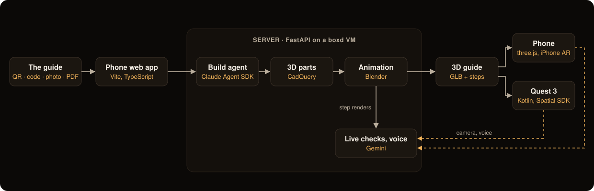

# Jarvis Assembler

Scan a flat-pack box with your phone. An agent finds the assembly guide, rebuilds it as an animated 3D model, and then guides the real build on your phone or in a Meta Quest 3, in Greek or English.

<https://agj.boxd.sh>

## How it works, in six steps

### 1 · Show it your furniture

The box just arrived and it is sitting on your floor. Scan the code on it, type its name, take a photo of it, or upload the guide if you have the PDF. We find the right assembly guide for you.

The app →   &nbsp;·&nbsp; Knowing the box from a photo →  &nbsp;·&nbsp; Finding the guide online → 

### 2 · An agent reads the guide

Paper guides are drawings with no words. An AI agent goes through every page and works out which parts there are, how many screws, and what happens in each step.

Reading the guide → 

### 3 · Every part is built in 3D

The agent draws each board and each screw as a real 3D shape, with the holes in the right places. If two parts do not fit together, it goes back and fixes them.

Drawing the parts →  &nbsp;·&nbsp; Checking that they fit →  &nbsp;·&nbsp; Odd shapes → 

### 4 · The guide becomes a 3D animation

The parts come together one move at a time, like a short film of the build. Each step is compared with the drawing in the original guide, to make sure it shows the same thing.

The animation →  &nbsp;·&nbsp; Comparing with the drawing → 

### 5 · Follow it on your phone

Go through the steps and turn the model to see it from any side. On an iPhone you can put it on your table at its real size. If you want help, point the camera at your parts and a voice coach tells you whether you got it right.

The 3D view →  &nbsp;·&nbsp; On your table →  &nbsp;·&nbsp; Checking through the camera →  &nbsp;·&nbsp; The voice coach → 

### 6 · Or put on the headset

With a Meta Quest 3 you see the guide on top of the real furniture. It lights up the board to pick up, shows where it goes, and tells you if you are holding the wrong one. You can talk to it, so your hands stay free.

The headset app →   &nbsp;·&nbsp; Seeing the boards →  &nbsp;·&nbsp; Checks and voice → 

## How it fits together

 Every model key stays on the server.

## For other agents

Any agent can use it through an MCP server with 11 tools, a command line, `/llms.txt` and an OpenAPI file. For example, a furniture shop's customer-support agent gets "I am stuck on step 4 of my wardrobe", finds that product's guide, and answers with the exact step in 3D and how to undo the mistake, with no person on the line.
