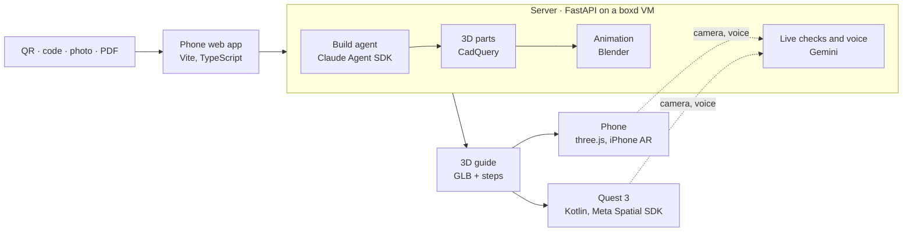

# Jarvis Assembler

Scan a flat-pack box with your phone. An agent finds the assembly guide, rebuilds it as an animated 3D model, and then guides the real build on your phone or in a Meta Quest 3, in Greek or English.

Gen AI Summit Hackathon, Athens, 14–15 Nov 2026 · Try it: <https://agj.boxd.sh> · Evidence and limits: [docs/SUBMISSION.md](docs/SUBMISSION.md)


## What the person does, in six steps

| # | Step | Built with |
|---|---|---|
| 1 | **Give the guide.** Scan the QR code or barcode on the box, type the product code or name, photograph the box, or upload the PDF. | Phone web app (Vite, TypeScript, jsQR). `gemini-4-hydrogen` recognises the product from a photo. A web-search agent (Claude Agent SDK) fetches the maker's PDF. |
| 2 | **The agent reads it.** It works out every part, screw and action in the guide. | Build agent on the Claude Agent SDK. |
| 3 | **The parts are built in 3D.** Each part is written as CAD code and corrected until everything fits. | CadQuery (Open CASCADE), our own fit checks (NumPy). Image-to-3D on fal for shapes CAD cannot draw. |
| 4 | **The guide is animated.** One action at a time, each step checked against the guide's own drawing. | Blender 5.3 headless (glTF, USDZ). `gemini-decision-1` compares each step with the drawing. |
| 5 | **Follow it on the phone.** A 3D walkthrough; life-size on your table on an iPhone. Or hold the camera over the parts and a coach checks them and speaks. | three.js, AR Quick Look (ARKit). Camera frames over a WebSocket to `gemini-decision-1`; Gemini Live (`gemini-3.8-live`) for the voice. |
| 6 | **Or build with the headset.** It finds each board on the floor, puts the 3D guide on the real part, checks the part in your hand, speaks, and takes voice commands. Nothing is printed or stuck on the furniture. | Native Quest 3 app (Kotlin, Meta Spatial SDK, passthrough camera, hand tracking, OpenCV on the device). Gemini for the checks, part finding and speech. |

## How it fits together



Every model key stays on the server. Other agents can use it too: an MCP server with 11 tools, a command line, `/llms.txt` and an OpenAPI file ([docs/API.md](docs/API.md)).

## Run it

Needs macOS or Linux, [uv](https://docs.astral.sh/uv/), Blender 5.3 and about 5 GB of disk.

```sh
make setup     # Python 3.12 venv with all packages
make env       # creates .env with a fresh DEMO_KEY; then add GEMINI_API_KEY to it
make dev       # server on http://localhost:8000
make smoke     # second terminal: build a test guide end to end (about 20 s)
```

Headset (Quest 3 in developer mode): `tools/quest/install.sh android`, then `tools/quest/run.sh android --job drawer --lang el`. Details: [quest-android/README.md](quest-android/README.md).

## More

- For the judges, what was measured on the headset and what is not proven: [docs/SUBMISSION.md](docs/SUBMISSION.md)
- Routes, MCP tools, command line, deploy: [docs/API.md](docs/API.md)
- Status, plan, who did what: [docs/HANDOFF.md](docs/HANDOFF.md), [docs/PLAN.md](docs/PLAN.md), [docs/PROGRESS.md](docs/PROGRESS.md)
- What we did not build ourselves: [CREDITS.md](CREDITS.md)
