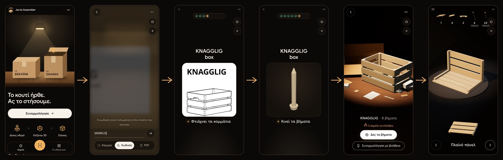

# Jarvis Assembler

**Scan a flat-pack box. An AI agent turns its paper guide into a 3D build you follow on your phone or in a Quest 3.**

<https://agj.boxd.sh>

**Who it's for.** Anyone who buys flat-pack furniture and builds it at home. And the shops that sell it, who take the calls when a build goes wrong.

**The problem.** Paper guides are drawings with no words. They cannot tell you which of two look-alike boards you are holding or which way round it goes, so you find the mistake three steps later and take it all apart.

**Our solution.** Scan the box and an AI agent rebuilds the guide as a 3D film, one move at a time. Then your phone or a Quest 3 watches the real build, shows where each part goes, and warns you before the mistake.



## How it works


## How it fits together


## For other agents

Any agent can use it through an MCP server with 11 tools. For example, a furniture shop's customer-support agent gets "I am stuck on step 3 of my box", asks the guide, and answers with the exact step and the part to pick up, with no person on the line.

<details open>
<summary><b>See a real call and its answer</b></summary>

The support agent calls one tool:

```json
{ "tool": "ask_guide", "job_id": "1115-1432-ef587a", "step": 3, "question": "What do I do in this step?" }
```

and gets back an answer it can say, the part to light up in the 3D view, and the page of the guide it came from:

```json
{
  "answer": "Turn the assembly upside down. Then place the second side panel against the open end of the bottom panel, as shown on page 4.",
  "actions": [{ "type": "highlight_part", "part_id": "side_panel" }],
  "undo": null,
  "cites": { "page": 4, "step": 3 },
  "latency_ms": 4116,
  "model": "gemini-4-hydrogen"
}
```

</details>
