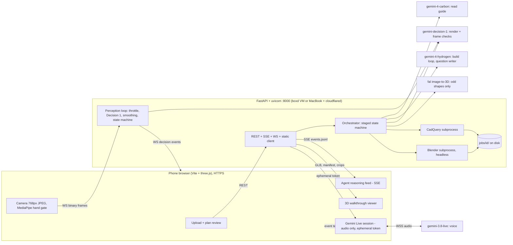

# Assembly Guide Agent: end-to-end technical plan

Status: build plan for the Gen AI Summit Hackathon, Athens. Written Saturday 14 Nov 2026, about 19:00. Code freeze is **Sunday 15 Nov 2026, 18:00** Athens time.

This plan merges four research sections, kept in `docs/research/` for detail and code:
- `01-phase1-pipeline.md`: guide to plan to parts to scene to GLB
- `02-mobile-client.md`: three.js viewer, camera, sensors, audio
- `03-live-perception-voice.md`: Decision 1 perception, decision logic, Gemini Live voice
- `04-backend-infra-team.md`: FastAPI, hosting, repo, testing, team, schedule, demo

**Where this file and a research section disagree, this file wins.** The decisions that settle each disagreement are listed in §1.

Conventions:
- **UNVERIFIED** means it was not confirmed against an official page or a test on our hardware.
- Every timing and cost figure is an **estimate** until measured.
- Model IDs were checked against Google's docs on 2026-11-14.

---

## 0. The product in one paragraph

A user uploads a flat-pack furniture assembly guide (PDF). An agent reads it, builds every part in 3D with CadQuery, and assembles them in Blender, one animated step per guide step in the guide's exact order. It checks each part and each step against the guide's own drawings and fixes its mistakes. The phone plays the result as a 3D walkthrough beside the guide's drawings (**phase 1**).

The phone then sits on a stand and watches the user build the real product. It confirms correct actions, warns before a mistake (wrong part, wrong way round, wrong hardware, out of order) and advances when a step is done. It does this through an always-on voice agent (**phase 2**).

**Grounding rules** (non-negotiable):
1. Every part and every step cites a guide page and the label printed there.
2. Part and hardware counts must equal the guide's parts list.
3. Nothing is invented. Values the guide does not print are flagged `estimated`.
4. Unclear drawings are flagged for a human, who approves the extracted plan before any 3D is built.

---

## 1. Decisions that override the research sections

| # | Topic | Conflict | Decision |
|---|---|---|---|
| D1 | Python version | Phase 1 said 3.12; backend said 3.13 (for the `bpy` wheel) | **Python 3.12 venv** for server and CadQuery. **Blender runs as its own app** (`blender -b -P script.py -- args.json`) with its bundled Python, so the `bpy` wheel is not used. `cadquery-ocp` has macOS arm64 and Linux wheels for cp311–cp314. |
| D2 | Where heavy work runs | Backend wanted the boxd VM first; Phase 1 assumed the MacBook | **Run the same render test on both at 21:00 Saturday** (§8.3). The winner hosts the pipeline. Default if both work: **boxd** (independent of laptop sleep and venue Wi‑Fi). The MacBook always keeps blender-mcp for interactive debugging. |
| D3 | Check-render engine | Workbench, EEVEE or Cycles | First test **Workbench**, then **EEVEE**, then **Cycles CPU, 4–16 samples + Freestyle**. Keep the first that produces non-black PNGs headless. On a GPU-less Linux VM, expect Cycles CPU. |
| D4 | Client hosting | Same-origin FastAPI vs Vercel + CORS | **Same origin**: FastAPI serves `client/dist` on the public HTTPS URL, so one QR code works with no CORS. Vercel is a **mirror** only, with `VITE_API_URL` pointing at the backend and CORS allowing that origin. |
| D5 | Build progress feed | WebSocket (backend) vs SSE (mobile) | **SSE** `GET /api/jobs/{id}/events` with `Last-Event-ID` replay from `events.jsonl`. **WebSocket** only for phase-2 perception. Event schema in §4.4. |
| D6 | Frames | 640 px q0.6/0.7 vs 768 px | **768 px long edge, JPEG q0.7**, cropped to the work area calibrated at session start. The server sends it to Decision 1 at `medium`. |
| D7 | Requests in flight | Client 1 vs server 2 | Client keeps **at most 2 frames un-acked**. Server keeps **at most 2 Decision 1 calls in flight**, drops stale frames, and replies to each frame `seq`. The client watchdog frees a slot after 2 s. |
| D8 | Fix attempts | 3 vs 4 | **3 fix attempts** per part and per step. Then keep the best attempt, add a flag, and move on. The pipeline never blocks on one part. |
| D9 | Live token endpoint | `/live-token` vs `/api/live/token`; 30 vs 60 min | `POST /api/live/token`, **single-use, 30-minute expiry, 1-minute window to start**, with config locked server-side. |
| D10 | Per-step manifest | Two different shapes | One merged `manifest.json` (§4.3). Part nodes are named `part_<ID>_<n>`. Instance `#` is not used in node names. |

---

## 2. Architecture



**Why it is shaped this way:**
- **Perception runs on the server.** Ephemeral tokens work only with the Live API, so a phone cannot call the Decisions API without exposing the key. The server also holds each step's reference images.
- **Voice runs phone-to-Google directly.** This saves a hop on the audio path, which keeps interruptions snappy. The system prompt stays locked inside the token.
- **The voice model never sees frames.** It gets short text events about state changes from the perception loop.

---

## 3. Models and services

| Job | Model / service | How it is called | Cost (Google/fal pages, 2026-11-14) | Key limits |
|---|---|---|---|---|
| Read the guide, extract the plan | `gemini-4-carbon` | Interactions API, structured output (Pydantic schema) | $2 / $10 per 1M tokens (intro price to 30 Nov) | Structured output on Carbon **UNVERIFIED**; fallback is Hydrogen at `xhigh` |
| Write CadQuery and Blender code, fix loops, write per-step questions | `gemini-4-hydrogen` | Interactions API, manual function calling, a fresh interaction per part and per step | $1.50 / $7.50 per 1M | Thinking `low/medium/high/xhigh`; 1M context. Images inside function results **UNVERIFIED**, so attach them as separate image parts |
| Compare renders with guide drawings; check live frames | `gemini-decision-1` | `POST /v1beta/decisions` (`client.decisions.create`, google-genai ≥3.2, `api_version="v1beta"`) | $0.10 per 1M input tokens; no output tokens | 150–250 ms end to end (Google's claim); no caching or batch; up to 1,000 questions; **Tier 1 needed** (1,500 RPM, 1M TPM, 50k RPD) |
| Always-on voice agent | `gemini-3.8-live` | Live API over WebSocket from the phone, ephemeral token, `responseModalities: ["AUDIO"]` | about $0.005/min audio in, $0.018/min audio out | Audio-only session 15 min, extended with session resumption and context compression; Greek supported; functions declared at setup |
| Fallback voice output | `gemini-3.8-flash-lite-tts`, browser `speechSynthesis` | Fixed phrases per event | small | Used if Live misbehaves |
| Fallback voice input | `gemini-3.5-transcribe-live` | Push-to-talk, then Hydrogen, then TTS | small | 10-minute sessions |
| Odd non-board parts (rare) | fal `fal-ai/hunyuan-3d/v3.1/pro/image-to-3d` ($0.375) or `meshy/v7.1/image-to-3d` ($0.80 untextured) | fal client | per call | Not planned for the demo guide |
| Exact part geometry | CadQuery 2.8 + `cadquery-ocp` | Subprocess, 30 s timeout | free | STL/STEP export; GLB only for Assemblies, so it is not used |
| Scene, animation, renders, GLB export | Blender 5.3 app | `blender -b --factory-startup -P script.py -- args.json` | free | Headless engine support to be tested (D3) |
| Interactive debugging and live demo of the Blender scene | blender-mcp (`uvx mcp-for-blender`, add-on socket on port 9876) | MCP from Claude/IDE | free | Dev only, never in the pipeline |
| Compute host | boxd VM (4 vCPU / 16 GB, resize to 8/32 for the demo) | CLI `boxd`, HTTPS `<name>.boxd.sh` on port 8000 | about €0.70/h at most at 8/32 | No GPU documented; CPU architecture **UNVERIFIED** (Blender Linux builds are x86-64) |

Optional sponsor tool: treg (a single token for 4,100+ pay-per-call tools) only if a real need appears. It is not needed for the core loop.

**Cost per guide in phase 1 (estimate):** about **$1**, budget $3, and **8–15 minutes**. Details in `01` §9.

**Phase 2 cost (estimate):** about **$3/hour at a constant 4 Hz**. With the adaptive rate (§6.3) it averages about $1.9/hour, plus voice at about $1.4/hour or less.

---

## 4. Contracts between components (agree these first, tonight)

### 4.1 Job folder (single source of truth)

```
jobs/<job_id>/
  guide.pdf
  pages/page-001.png ...             # 200 dpi rasters (PyMuPDF)
  crops/part-A.png  step-03.png ...  # 300 dpi crops from box_2d
  plan.json  plan.approved.json      # build stages read ONLY the approved plan
  parts/A.py  A.stl  A.step  A.mates.json
  renders/part-A-v2.png  step-03-cand1.png  check-*.json
  refs/step-03-ref.png  step-03-sheet.png   # phase-2 reference render + composite sheet
  scene.blend
  walkthrough.glb  manifest.json
  events.jsonl                       # append-only; feeds SSE and post-mortem
  stages/<stage>.done  logs/*.stderr
```

### 4.2 Plan JSON (`plan.json`)

The full Pydantic schema is in `docs/research/01-phase1-pipeline.md` §2. Summary:
- **Part:** `{id (printed label), name, count, shape, dims_mm{…: Estimate}, features[{id, kind, face, pos_uv, diameter_mm?}], cite{page,label,box_2d}, drawing?}`
- **Hardware:** `{code (printed), kind, count, length_mm?, cite}`
- **Step:** `{n, cite, parts_added[], hardware_used{code: qty}, mates[{moving_part, moving_feature, fixed_part, fixed_feature, type: insert|flush|edge_on_face, hardware?}], view, view_az_el_deg, flip_whole_assembly, notes}`
- **Flag:** `{ref, kind: unclear_drawing|count_mismatch|estimated_dims|unclear_box|ambiguous_mate, message}`
- **Estimate:** `{value, estimated: bool, basis}`. `estimated` is true unless the number is printed in the guide.
- `box_2d` is `[ymin, xmin, ymax, xmax]` normalised 0–1000 on the page raster.

Code validation after extraction:
- Σ `hardware_used[code]` over all steps == `Hardware.count`.
- Part instances used == `Part.count`.
- Every mate references existing parts and features.

A failure produces a `count_mismatch` flag that the human must resolve before approving.

### 4.3 `manifest.json` (merged contract for the viewer and phase 2)

```json
{
  "jobId": "abc", "title": "LACK side table", "glb": "walkthrough.glb", "units": "m",
  "parts": [{"id": "A", "name": "Side panel", "nodes": ["part_A_1", "part_A_2"], "thumb": "renders/part-A-v2.png", "cite": {"page": 2, "label": "A"}}],
  "hardware": [{"code": "101350", "kind": "dowel", "count": 8, "nodes": ["hw_101350_1", "..."], "cite": {"page": 2, "label": "101350"}}],
  "steps": [{
    "n": 3, "clip": "step_03", "title": "Attach side panel A to base C",
    "visible": ["part_C_1", "part_A_1", "hw_101350_1"],
    "pickParts": ["A"], "hardware": [{"code": "101350", "qty": 4}],
    "camera": {"node": "cam_step_03", "pos": [0.9, 0.7, 0.9], "target": [0, 0.2, 0], "ortho_height": 0.9},
    "crop": "crops/step-03.png", "cite": {"page": 4, "label": "3"},
    "refRender": "refs/step-03-ref.png", "refSheet": "refs/step-03-sheet.png",
    "check": {"pass": true, "score": 0.86}, "flags": []
  }]
}
```

The viewer and the exporter share these rules:
- **Animations:** one glTF animation per step, named `step_NN` in guide order. Each animation touches **only the nodes that move in that step**, with absolute keyframes.
- **Visibility:** glTF cannot toggle visibility, so the viewer shows `visible` nodes in their final pose and hides the rest.
- **Units:** metres, Y-up.
- **Camera:** an optional per-step camera node named `cam_step_NN`.

### 4.4 Event schema (`events.jsonl`, streamed over SSE)

```json
{"seq": 42, "ts": 1763150000123, "jobId": "abc", "stage": "parts",
 "type": "thought|tool_call|tool_result|image|part_status|step_ready|approval_required|progress|error|done",
 "level": "info|warn|success|error", "partId": "B", "stepN": null,
 "text": "Part B rejected: holes on wrong face, regenerating",
 "tool": "run_cadquery", "ms": 812, "progress": 0.38, "image_url": "/files/abc/renders/part-B-v2.png"}
```

Rules:
- `seq` is the SSE `id`, which lets a reconnecting client replay from `Last-Event-ID`.
- Code in `args` is truncated to 400 characters, with a link to the full file.
- Events are written to disk **before** the action is considered complete.

### 4.5 REST, SSE and WebSocket endpoints

Every route requires the demo key (`X-Demo-Key` header, or `?key=` for SSE, WebSocket and QR links), because the URL is public.

| Method | Path | Request → Response |
|---|---|---|
| POST | `/api/jobs` | multipart `file=guide.pdf` → `{job_id, stage:"ingesting"}` |
| GET | `/api/jobs/{id}` | → `{stage, status, progress, error?, last_seq}` |
| GET | `/api/jobs/{id}/events` | SSE stream of §4.4 events |
| GET | `/api/jobs/{id}/plan` | → `plan.json` + crop URLs |
| POST | `/api/jobs/{id}/plan/approve` | `{plan?: edited, note?}` → `{stage:"building"}` |
| POST | `/api/jobs/{id}/retry` | `{from_stage}` → `{stage}` (deletes later `.done` markers) |
| GET | `/files/{id}/{path}` | static file from the job folder (GLB, crops, renders, manifest) |
| POST | `/api/live/token` | `{job_id}` → `{token, expires_at, model:"gemini-3.8-live"}` (rate-limited to 1 per 10 s per IP) |
| WS | `/ws/perception/{job_id}` | see below |
| GET | `/healthz` | → `{ok, blender_version, cadquery_ok, job_running}` |

**The perception WebSocket protocol:**
- **Phone to server, control messages** (JSON text): `{type:"start", step}`, `{type:"step", n}`, `{type:"show_part", expected?}`, `{type:"stop"}`.
- **Phone to server, frames** (binary): `[uint32 header_len][JSON header {seq, step, ts, hint:"low"|"medium"|"high"}][JPEG bytes]`.
- **Server to phone, one reply per frame:** `{type:"ack", seq, latency_ms}`.
- **Server to phone, state-change events:** `{type:"event", event:"wrong_part"|"flip_needed"|"wrong_hardware"|"out_of_order"|"step_complete"|"unsure_show_part"|"vision_paused", step, page, expected, observed, evidence:{question: prob}, ts}`.

---

## 5. Phase 1: guide → plan → parts → scene → GLB

Detail and code: `docs/research/01-phase1-pipeline.md`.

**Control flow.** A **Python orchestrator owns the flow** (stages, loops, caps). Hydrogen gets a small tool set inside each loop, in a fresh interaction per part and per step. One long autonomous conversation would be unpredictable, expensive (context is re-billed every turn) and hard to debug in 24 hours.

```
INGEST → EXTRACT_PLAN (Carbon) → AWAIT_APPROVAL ⏸ → PARTS → PLACE → STEPS → REFS → EXPORT → DONE
```

### 5.1 Ingest and plan extraction

1. **Rasterise.** PyMuPDF renders every page to PNG at 200 dpi and extracts its native text (`page.get_text()`).
2. **Extract.** `gemini-4-carbon` receives every page image at `resolution:"high"` plus its native text, and returns the `Plan` as structured output. It returns `box_2d` for every part drawing, step drawing and the parts-list table.
3. **Crop.** Crops are cut at 300 dpi from the PDF using the boxes.
4. **Re-check the boxes.** A cheap second pass (Hydrogen, `thinking: low`) re-detects the boxes per page. Any box whose IoU with Carbon's box is below 0.7 gets an `unclear_box` flag.
5. **Validate.** Code checks the counts (§4.2).
6. **Approve.** The approval screen shows each crop next to its JSON entry. The human fixes flags and taps Approve. Only `plan.approved.json` is used from here on.

### 5.2 Parts in CadQuery

**Template.** Hydrogen edits only `PARAMS` and the `build()` body. A fixed harness:
- exports STL (tolerance 0.05 mm) and STEP
- writes `<part>.mates.json`, a set of named frames (`origin`, `axis`) per `Feature.id`
- fails with a list of missing ids if any plan feature has no frame

```python
PARAMS = {"L": 720, "W": 300, "T": 18, "dowel_d": 8, "dowel_depth": 12}  # mm, estimated per plan
def build(p):
    b = cq.Workplane("XY").box(p["L"], p["W"], p["T"]); frames = {}
    for i, x in enumerate([-p["L"]/2 + 32, p["L"]/2 - 32]):
        b = b.faces(">Z").workplane(centerOption="CenterOfBoundBox").center(x, 0).hole(p["dowel_d"], p["dowel_depth"])
        frames[f"h{i+1}"] = {"origin": [x, 0, p["T"]/2], "axis": [0, 0, 1]}
    return b, frames
```

**Runtime.** Each run is a subprocess with a 30 s timeout. The traceback goes back to the agent on failure.

**Scale.** Guides rarely print dimensions, so absolute scale comes from the product's published overall size and is marked `estimated`.

**Part loop.**
1. Write the script.
2. Run CadQuery.
3. Render the part in batched Blender, posed like the guide drawing (orthographic, guide angle).
4. Compare (§5.5).
5. Fix and repeat, at most **3** times.

### 5.3 Placement (deterministic code, not the LLM)

The agent proposes mates in the plan. Code computes the transforms, step by step in guide order:
- The base part is fixed at identity.
- **One `insert` or `flush` mate:** align the axes and make the origins coincide. The remaining spin is resolved by a second mate, or by the 90° rotation that keeps bounding boxes from colliding.
- **Two or more point mates:** Kabsch/SVD on the matched origins, then check that the axes agree.
- **Symmetric hole patterns** give 2–4 **flip candidates**. All are kept, and the step check picks one with a single Decision 1 `choice` question.
- **Hardware:** dowels and bolts are placed at the fixed hole frame, along its axis.
- **Units:** mm × 0.001 converts to metres on import.

CadQuery's `Assembly.constrain/solve` is the fallback.

### 5.4 Scene, animation, export (Blender)

- **One Blender process per batch**, not per part: startup is about 3–5 s.
- **Animation.** For step *k*:
  - every moving object gets an action `step_kk__<obj>` on an NLA track named `step_kk`
  - each part moves from an exploded start (final position minus 1.5 × part size along its insert axis) to its final position over 2 s
  - hardware starts 60 mm out along its hole axis
- **Export:**

```python
bpy.ops.export_scene.gltf(filepath="walkthrough.glb", export_format="GLB",
    export_animations=True, export_animation_mode="NLA_TRACKS",
    export_merge_animation="NLA_TRACK", export_anim_slide_to_zero=True,
    export_force_sampling=True, export_cameras=True, export_yup=True)
```

- **Compress.** Run `gltfpack -cc`, or `gltf-transform optimize` with meshopt. Targets: ≤ 5 MB, ≤ 150k triangles, ≤ 100 draw calls. Repeated hardware is instanced or merged.
- **Phase-2 reference images.** Blender also renders these per step:
  - `refs/step-NN-ref.png`: the correct end state, from a viewpoint close to a phone on a stand (front, about 35° above the table)
  - `refs/step-NN-sheet.png`: a **composite sheet**, with the reference render on the left and a labelled grid of candidate parts and hardware on the right. Candidates are this step's parts, look-alikes such as mirror panels, and the next step's parts.

### 5.5 Verification (part and step)

1. **Deterministic pre-check** with OpenCV (~10 ms). Run Canny on both images, fill the outer contour, then compute silhouette IoU and the aspect-ratio difference. Mask the guide's label text using PyMuPDF text positions.
   - `IoU < 0.4`: fix the proportions immediately without calling Decision 1.
   - `IoU ≥ 0.75`: still confirm once with Decision 1.
2. **Decision 1** gets two images at `medium` (about 1.4k tokens, about $0.00014 per call).

   | Check | Questions |
   |---|---|
   | Part | `same_part` (yes/no), `holes_match` (yes/no), `proportions` (score, 4 levels), `main_issue` (choice: `extra_feature`, `missing_feature`, `none`, `orientation`, `proportions`, `thickness`) |
   | Step | `parts_present`, `orientation` (choice: `correct`, `flipped_front_back`, `flipped_left_right`, `rotated_90`, `upside_down`, `wrong_part`), `position` (score), `hardware_visible` |
   | Flip candidates | One `choice` question across `cand_a…cand_d` |

3. **Accept** a part when `same_part ≥ 0.8`, `holes_match ≥ 0.7` and `proportions ≥ 2.0`. **Accept** a step when `parts_present ≥ 0.8`, `orientation == correct` and `position ≥ 2.0`.
4. **Give up** after 3 attempts, or after 2 attempts with no improvement. Keep the best attempt, add an `unclear_drawing` flag, and the viewer shows a "needs human check" badge.
5. **What the fixer may change:** `PARAMS`/`build()` for parts; flip, view or mate choice for steps. It may **never** change counts or labels.

### 5.6 Tools available to Hydrogen

| Tool | Args | Returns | Timeout |
|---|---|---|---|
| `get_plan` / `get_crop` | `{ref: "part:A"\|"step:3"}` | JSON / PNG (as an image part) | 5 s |
| `write_part_script` | `{part_id, params:{}, build_src}` | `{path}` | 5 s |
| `run_cadquery` | `{part_id}` | `{ok, stl, frames[], bbox_mm, error?}` | 30 s |
| `render_part` | `{part_id, part_view:[rx,ry,rz], az_el:[a,e]}` | PNG | 60 s |
| `compare_with_guide` | `{ref, render}` | `{iou, aspect_diff, decision{…}, pass}` | 30 s |
| `place_part` | `{step, instance, mates[], flip?}` | `{transform, candidates, collisions[]}` | 30 s |
| `render_step` | `{step, candidate?}` | PNG | 120 s |
| `compare_step` | `{step, renders[]}` | `{decision{…}, best_candidate, pass}` | 30 s |
| `flag_for_human` | `{ref, kind, message}` | `{ok}` | – |
| `generate_odd_part` | `{part_id}` | GLB via fal | 180 s |
| `export_glb` | `{}` | `{glb, manifest}` (orchestrator only) | 120 s |

Run limits:
- Manual function calling, so every call is logged to `events.jsonl` first.
- Only the last 2 rendered images stay in context.
- `MAX_ITERS = 60` per job and a **wall budget of 40 minutes**.
- Two identical consecutive tool calls return an error to the model.
- Thinking levels: `medium` for writing scripts, `high` for fixing steps, `low` for re-checking boxes.

---

## 6. Phase 2: live perception and voice

Detail, the full example request, and the evaluation plan: `docs/research/03-live-perception-voice.md`.

### 6.1 What one perception request contains (per frame)

| Input block | Resolution | Tokens |
|---|---|---|
| Step header text from the plan (page, parts, hardware with codes, orientation cues) | – | ~250 |
| Live frame (768 px, work-area crop) | `medium` | 560 |
| Explanation of the composite layout | – | ~40 |
| Composite reference sheet `refs/step-NN-sheet.png` | `medium` | 560 |
| ~11 questions | – | ~700 |

That is **about 2,070 tokens per request**. A composite sheet costs one image instead of two or three separate ones, which matters because the Decisions API has no caching.

**Questions per step.** Hydrogen writes the step-specific questions once per step when the guide loads, using a fixed template, and they are cached. The template's questions:
- `part_in_hand`: a choice over the candidate part labels plus `hardware_only`, `nothing_held` and `other`
- `right_part`, `orientation_ok` (with true/false descriptions from the plan), `panel_on_base`, `step_complete`, `next_step_part_used`: yes/no
- `hardware_in_hand`: a choice over the hardware codes plus `no_hardware` and `other`
- fixed generic questions: `hands_present`, `view_blocked`, `image_poor`, `frame_matches_setup`

Choice keys are descriptive and include an explicit `other`, because the API sorts option keys alphabetically.

### 6.2 Decision logic

- **Thresholds** (starting values, tuned by eval):
  - yes/no is positive at ≥ 0.85 and negative at ≤ 0.15; anything between is unknown
  - a choice counts only when its confidence is ≥ 0.75 and the answer is not `other`
  - a frame is discarded when `image_poor` or `view_blocked` is ≥ 0.3
- **Cross-check:** `wrong_part` fires only when `right_part` is negative **and** `part_in_hand` confidently names a different part.
- **Smoothing:** an event needs N agreeing usable frames out of the last M.

  | Event | N of M | Notes |
  |---|---|---|
  | `wrong_part` | 4 of 5 | |
  | `flip_needed` | 5 of 6 | |
  | `wrong_hardware` | 4 of 5 | |
  | `out_of_order` | 6 of 8 | |
  | `step_complete` | 8 of 10 | also needs hands out of view or the assembly stable for 2 s |
  | `unsure_show_part` | 8 consecutive unknowns | while the user is holding something |

- **Hysteresis:** leaving a state needs opposite evidence; a lack of evidence is not enough.
- **State machine per step:** `WAITING_FOR_PART → PART_IN_HAND → PLACING → STEP_COMPLETE` (load the next step's questions and sheet).
- **Cooldowns:**
  - the same event on the same step is spoken at most once every 20 s
  - at least 6 s between any two unprompted utterances
  - `step_complete` is never suppressed
  - "I know" / "το ξέρω" mutes that event type for the step
- **Warning before the mistake** works for: wrong panel picked up, mirror panel (when the hole face is visible), wrong orientation while holding, wrong hardware in hand, next step's part brought over.
- **Detected only after:** wrong placement, missing dowel, cam lock not turned. For these the voice says "please check step N, page P", never "wrong".

### 6.3 Rate, latency, cost

- **Adaptive rate**, driven by the phone's MediaPipe hand gate:

  | Hand state | Action |
  |---|---|
  | Hands moving fast | Send nothing |
  | Hands present and still | 2–4 Hz |
  | Hand raised, holding something | Send immediately |
  | Hands leave after activity | Send one "step done?" frame. This is the most valuable frame, because the work area is unblocked. |
  | Idle | 0.5–1 Hz keep-alive |

  The maximum is 4 Hz, which is 240 requests per minute and ~500k tokens per minute. **The free tier cannot do this** (200 RPM, 50k TPM). **Link billing and get Tier 1 in the first hour.**
- **Cost:** about $2.98/h at a constant 4 Hz, and about $1.9/h on average with the adaptive rate (estimate). Tier 1's 50k requests per day is about 3.5 h at 4 Hz. Ration eval replays.
- **Latency budget (estimate):**
  - capture and encode ~30 ms
  - upload 40–80 ms
  - Decision 1 150–250 ms
  - event smoothing ~1.25 s
  - Live speech onset 0.5–1 s (**UNVERIFIED**)
  - **total from action to spoken warning: about 2–2.5 s**

### 6.4 Voice agent (Gemini 3.8 Live, audio only)

- **Why audio only:** audio+video sessions are capped at 2 minutes, and Live sees video at only 1 frame per second. Vision therefore goes through Decision 1.
- **Connection:**
  1. The backend mints a single-use ephemeral token with `model`, `system_instruction`, tools and `session_resumption` locked.
  2. The phone connects with `new GoogleGenAI({apiKey: token.name, httpOptions:{apiVersion:"v1beta"}}).live.connect(...)`.
- **Audio:** the mic is captured at the device rate and downsampled in an AudioWorklet to 16 kHz Int16 PCM (`audio/pcm;rate=16000`) in 40 ms chunks. Playback is 24 kHz PCM, scheduled back to back. On `interrupted: true`, stop all sources and clear the queue.
- **Event injection** (from the capabilities page; must be tested):
  - Background state such as "step changed": `sendClientContent({turns:[{role:"user", parts:[{text:"[PERCEPTION] …"}]}], turnComplete:false})`. The model knows and stays quiet.
  - Warnings and `step_complete`: the same call with `turnComplete:true`, only when the user is not speaking. Otherwise hold it for up to 3 s.
  - Example: `[PERCEPTION event=wrong_part step=4 page=6 expected="left side panel A" observed="right side panel B" p=0.93] Tell the user briefly, cite step 4 page 6.`
- **Tools the voice agent can call:**
  - `get_current_step`
  - `next_step`, `previous_step`, `go_to_step(step)`
  - `highlight_part(part_id)`
  - `repeat_instruction`
  - `show_part_request(expected_part_id?)`: triggers a one-off check with the frame at `high`

  Navigation tools are non-blocking and answered when idle. The phone answers tool calls with `sendToolResponse`.
- **System instruction rules:**
  - Greek or English, matching the user.
  - Every correction names the step and page.
  - Never claim to see anything that is not in a PERCEPTION message or tool result.
  - Speak only when spoken to, on a warning or on step completion.
  - When unsure, ask the user to show the part.
  - At most two sentences per utterance.
- **Long sessions:**
  - Enable `sessionResumption` and `contextWindowCompression: {slidingWindow:{}}`.
  - Keep the latest resumption handle.
  - On `goAway` or a close, reconnect with the handle, then re-send a `[STATE] step=n` background turn.
- **Noise:**
  - Automatic activity detection with `silence_duration_ms: 600` and `START_SENSITIVITY_LOW`.
  - Earphones in the demo.
- **If Gemini Live misbehaves:**
  - **ElevenLabs Agents** (`@elevenlabs/react`, client tools, `sendContextualUpdate` adds context without a reply). About $0.08/min; Greek support **UNVERIFIED**.
  - **Deterministic fallback:** a fixed phrase per event, spoken by `gemini-3.8-flash-lite-tts` or browser `speechSynthesis`, with push-to-talk questions answered through `gemini-3.5-transcribe-live`, Hydrogen and TTS. This is also the demo-day safety net.

### 6.5 Failure handling

| Failure | Response |
|---|---|
| Dark or blurry frame | Drop it. After 5 s of bad frames, say once: "more light please". |
| Hands covering the work area | Exclude the frame. Never fire `step_complete` while the view is blocked. |
| Near-identical panels (top-2 margin < 0.2) | `unsure_show_part`, then a `high`-resolution check of the held-up part. |
| Camera moved (`frame_matches_setup` low for 10 s) | Pause warnings and show a "re-align phone" overlay. |
| Decision timeout (> 800 ms) or 5xx | The frame doesn't count. After 3 s with no success, show a grey "vision paused" badge and mute warnings. Back off from 250 ms. |
| 429 rate limit | Drop to 1 Hz for 30 s. |
| Safety 400 | Treat as an unusable frame. Never retry it. After 3 in a row, tighten the crop and use `low`. |
| Live socket drops | Resume with the handle. Meanwhile the fallback voice speaks queued events. |

---

## 7. Mobile client

Detail and code skeletons: `docs/research/02-mobile-client.md`.

| Area | Decision |
|---|---|
| Stack | Vite + TypeScript, vanilla (no React), **three.js r187 pinned** (`three@0.187.0`): GLTFLoader + MeshoptDecoder, OrbitControls, AnimationMixer, RoomEnvironment. A manifest file only, no service worker (avoids stale builds on judges' phones). Fallback: `<model-viewer>` per step if the viewer isn't working by Sunday 10:00. |
| Screens | Upload → plan review (crop beside each JSON entry, flags, Approve) → build feed (SSE) → walkthrough → "Start assembling" (phase 2). |
| Step playback | Clip `step_NN` with `LoopOnce` and `clampWhenFinished`. Show `visible` nodes in their final pose from earlier steps, then play the current clip. Play, pause, scrub, replay, and a "Next" button on `finished`. |
| Highlighting | Pulse the emissive glow of `pickParts` and fade the other parts to 0.35 opacity. No OutlinePass (too expensive on mid-range phones). The same call is used by phase 2. |
| Camera | 600 ms tween to `cam_step_NN` or the manifest camera, free orbit, "re-center" button. |
| Layout | Portrait: header / 3D view ~58% of height / guide crop + hardware chips ~30% / controls. Landscape: side by side. `100dvh`. |
| HTTPS | Dev: `cloudflared tunnel --url http://localhost:5173` (add `server.allowedHosts: ['.trycloudflare.com']` in Vite). Demo: same origin as the backend (D4), Vercel mirror. |
| Camera capture | `getUserMedia({video:{facingMode:{ideal:'environment'}, width:{ideal:1280}, height:{ideal:720}}})`, `<video playsinline muted autoplay>`. `canvas.drawImage` + `toBlob('image/jpeg', 0.7)` at 768 px (works on iOS; `ImageCapture` is Chromium-only). |
| On-device gating | `@mediapipe/tasks-vision` HandLandmarker (VIDEO mode, GPU delegate) in a worker at about 8 Hz, driving the gate in §6.3. `?gate=0` disables it. Cost on mid-range phones is **UNVERIFIED**; if a call takes over 60 ms, lower the rate and track one hand. |
| Audio | AudioContext created inside the "Start assembling" tap (iOS rule). Echo cancellation, noise suppression and auto gain on. Earphones recommended. Handle iOS context suspension with a "tap to resume" overlay. |
| Device | Wake Lock (re-request on `visibilitychange`; iOS 18.4+ **UNVERIFIED**). Vibration on Android only; iOS gets a sound tick and a coloured screen flash. Pixel ratio ≤ 2. Render only when something changes. Keep the phone plugged in on the stand. |
| Budgets | GLB ≤ 5 MB, ≤ 150k triangles, ≤ 100 draw calls, orbit ≥ 45 fps, frame grab < 25 ms, frame round trip p50 < 500 ms, first render after `done` < 3 s on 4G. |

Client folder layout:

```
client/src/main.ts  api.ts  ui/{upload,review,feed,stepbar}.ts
client/src/viewer/{Viewer,steps,highlight,cameraRig}.ts
client/src/assist/{camera,frameLoop,gate,hands.worker,live,device}.ts  assist/audio/{mic-worklet,player}.ts
```

---

## 8. Backend and infrastructure

Detail: `docs/research/04-backend-infra-team.md`.

### 8.1 Stack

- **Server:** Python 3.12, FastAPI + uvicorn, `pydantic-settings`, `google-genai` ≥3.2, PyMuPDF, OpenCV-headless, numpy, cadquery.
- **One process, one job at a time:** an `asyncio.Lock`, each job runs as an `asyncio.Task`, heavy steps run through `asyncio.create_subprocess_exec` with `wait_for` timeouts and are killed on timeout. **No Redis or queue.**
- **Stages are re-runnable:** each writes its outputs through an atomic rename, then a `stages/<stage>.done` marker with the input hash. A restarted job skips completed stages, and `retry` deletes markers from a chosen stage onward.
- **Pipeline scripts:** each takes one JSON arguments file and prints one `RESULT {...}` line, which the tool handler parses.

### 8.2 Secrets

- **Server `.env`:** `GEMINI_API_KEY`, `FAL_KEY`, `BOXD_API_KEY`, `DEMO_KEY`, `JOBS_DIR`, optional `TREG_TOKEN`. Only `.env.example` is committed.
- **The phone never sees `GEMINI_API_KEY`.** It gets only the single-use Live token.
- **`DEMO_KEY` on every route,** because boxd URLs are public. It protects the Gemini spend.
- **Before every push,** run `git grep -n "AIza"`, or gitleaks.
- **`.gitignore`:** `.env`, `jobs/`, `.venv/`, `client/dist/`, `*.blend1`, `eval/**/clips/`.

### 8.3 Hosting decision test (21:00 Saturday)

| | boxd VM `agj` | MacBook Air M4 + cloudflared |
|---|---|---|
| Check | `uname -m` must be x86_64 (Blender Linux builds are x86-64); headless render of a test scene under 60 s | Headless render with Workbench, then EEVEE, then Cycles |
| HTTPS | `https://agj.boxd.sh` (port 8000, WebSockets supported) | `trycloudflare.com` random URL (no-account use **UNVERIFIED**) |
| Risk | No GPU, so Cycles CPU only | Laptop must stay awake (`caffeinate -dims`) and online |

Both pass: boxd hosts the pipeline. Only the Mac passes: the Mac hosts the pipeline. Either way, the boxd VM can still host the API and the static client.

**Demo networking:** the demo phone uses its own mobile data, and a second phone is the laptop's hotspot. Do not depend on venue Wi‑Fi.

### 8.4 Repository layout

```
/client      Vite + three.js app
/server      app.py, routes/, orchestrator/, tools/, perception/, live_token.py, settings.py
/pipeline    cad/run_part.py, cad/lib.py (dowel, cam-lock helpers)
             blender/render_parts.py, scene.py, animate.py, render_step.py, refs.py, export_glb.py
/prompts     carbon_extract_plan.md, hydrogen_part.md, hydrogen_step_fix.md, hydrogen_questions.md, live_voice.md
/eval        golden/<guide>/{guide.pdf, expected_plan.json}, score_plan.py, smoke.sh, phase2/{labels.json, replay.py}
/docs        PLAN.md (this file), research/
CREDITS.md  README.md  .env.example  Makefile (dev, smoke, deploy-box)
```

Conventions:
- Prompts live in files, and their version is logged in the events.
- Short branches, squash-merged to `main`. `main` always passes `make smoke`.
- `CREDITS.md` lists every third-party repo, snippet, model and the guide PDFs, each with its URL and licence. The hackathon rules require crediting what we did not build. The blender-mcp licence must be checked before it is listed.

---

## 9. Testing and evaluation

| Test | What | Pass criterion |
|---|---|---|
| Golden guide (choose by 20:30 Sat) | One simple panel-furniture guide (≤ 8 unique parts, ≤ 10 steps) plus a hand-written `expected_plan.json` | `score_plan.py`: part recall ≥ 0.9; exact counts for ≥ 80% of parts; step-order Kendall τ ≥ 0.8 |
| Smoke | `eval/smoke.sh BASE KEY`: health, upload, wait for approval, approve, wait for done, check the GLB has one animation per step (`npx @gltf-transform/cli inspect`) | Exit 0. Run before every merge after 02:00 and before recording. |
| First GLB contract test (tonight) | A hand-made two-step GLB plus manifest, loaded on a real phone | Clips play and clamp, visibility is right, no blending artifacts |
| Phase 2 offline (Sat night / Sun morning) | 5 clips of 20–40 s at the demo angle: correct step; wrong panel; upside-down then flipped; wrong hardware; bad light with hands in the way. Labelled at 4 Hz (~600 frames), replayed through the real WebSocket route. | Event accuracy ≥ 70%; **0 false alarms** on the correct clip; detection < 2 s; Decision p50 ≤ 250 ms / p95 ≤ 600 ms; frame-to-phone event p50 ≤ 500 ms. Replay cost about $0.50. |
| Voice smoke | 20 background (`turnComplete:false`) injections; 10 warnings; talking over a warning | 0 unprompted replies; every warning cites step and page; interruptions work |

Thresholds are tuned on the phase-2 clips:
- Each yes/no threshold is the lowest value that gives ≥ 0.95 precision on the warnings that trigger speech.
- N of M is the smallest window with zero false events.
- Questions with AUC below 0.8 get rewritten criteria.

---

## 10. Team and schedule

| Person | Role | Owns |
|---|---|---|
| A | Backend and infra lead | FastAPI, SSE/WS, orchestrator skeleton, boxd or Mac host, smoke, `CREDITS.md` |
| B | Agent and prompts | Carbon extraction, Hydrogen loops, tool schemas, golden plan eval, step-question writer |
| C | CAD and Blender | CadQuery harness and helpers, Blender render/scene/animate/refs/export scripts, blender-mcp debugging |
| D | Phone client | Viewer, plan review, feed, layout, QR; later the phase-2 camera loop and hand gate |
| E | Phase 2 and story | Perception loop, Live voice, clip recording and eval; owns the video and pitch from 13:00 Sunday |

**First hour (now to about 20:00):**
- **AI Studio and billing (A):** link billing and confirm **Tier 1**, create `GEMINI_API_KEY`, and call each model once: `gemini-4-carbon`, `gemini-4-hydrogen`, `gemini-decision-1` through `/v1beta/decisions`, and a Live connection with an ephemeral token.
- **boxd (A):** `boxd auth login` and add a payment method (without it the org is capped at 2 machines), then create the VM `agj`.
- **Installs:**
  - everyone: Python 3.12 venv (`uv venv -p 3.12`), with `cadquery google-genai fastapi "uvicorn[standard]" pymupdf opencv-python-headless numpy pydantic-settings`
  - A and C: Blender 5.3 on the Macs
  - D: Node with `three@0.187.0`, plus `cloudflared` from brew
- **fal key** (one image-to-3D model chosen). treg token is optional.
- **Golden guide and product** chosen by 20:30, and B starts `expected_plan.json`.
- **Repo skeleton pushed:** layout, `.gitignore`, `.env.example`, `CREDITS.md`, and the contracts in §4 copied to `/docs`.

| Time | A | B | C | D | E |
|---|---|---|---|---|---|
| Sat 20–21 | API skeleton, `/healthz`, events.jsonl + SSE | Carbon extraction on the golden guide | **Render test on Mac and boxd (D2/D3)** | Two-step dummy GLB in the viewer | Decision 1 on still photos; Live token flow |
| 21:00 | **Hosting decision** (§8.3) | | | | |
| 21–24 | Orchestrator stages, approval gate, deploy | Plan validation, crops, approval data | CadQuery harness + 3 golden parts; render_parts batch | Upload, plan review, feed | Perception WS route, composite sheet spec |
| **00:00** | **GO/NO-GO phase 1:** golden guide gives a walkthrough with ≥ 3 animated steps on a phone (a hand-fixed plan is allowed). If no-go: parts are boxes with the right proportions, and E joins phase 1. | | | | |
| 00–03 | Integration, retries, smoke | Hydrogen part loop and checks | Placement, animate, export, refs | Walkthrough player, highlighting | Record and label the 5 clips |
| Sleep | 03:00–08:00 | 01:00–07:00 | 03:00–08:30 | 01:00–07:00 | 02:00–08:00 |
| Sun 08–11 | Smoke on host, performance | Step fix loop, plan accuracy | Visual polish, crops, sheets | UI polish, phase-2 camera loop | Replay eval, thresholds, voice smoke |
| **11:00** | **Phase-2 decision:** GO if replay accuracy ≥ 70%, 0 false alarms on the correct clip, event p50 ≤ 500 ms, and Live speaks an injected event. Otherwise phase 2 becomes "tap to check this step" (one frame plus a spoken result) or is cut. | | | | |
| 11–13 | Hardening, resize VM | Second guide (stretch) | Fix failing parts | Phase-2 UI, hand gate | Phase-2 integration |
| **13:00** | **Record backup phase-1 footage** (screen and phone) | | | | |
| **15:00** | **Feature freeze:** bug fixes only | | | | |
| 15–16:30 | Final smoke, README | Freeze prompts | Pre-build the demo job | Final UI | Shoot the video |
| 16:30–17:30 | Edit video (E+D), README/CREDITS (A), repo cleanup (B+C) | | | | |
| **17:30** | **Submit** (30-minute buffer before 18:00) | | | | |
| 18–19 | Pitch rehearsal ×3 with a timer, fallback drill | | | | |

---

## 11. Demo

**1-minute video:**

| Seconds | Shot |
|---|---|
| 0–5 | A pile of flat-pack parts and a paper guide. "Paper guides are hard." |
| 5–15 | The phone uploads the PDF; the plan appears with crops; a person taps Approve. |
| 15–30 | Sped-up agent feed: CadQuery code, a render next to the guide drawing, a check passes; "Part B rejected: holes on wrong face, regenerating"; the Blender scene assembles. |
| 30–42 | The walkthrough on the phone: swiping through steps, each 3D animation beside its guide drawing. |
| 42–56 | Phase 2: the phone on a stand. The user picks the wrong panel: "That's panel C. Step 4 needs panel B, the shorter one." They hold it upside down: "Flip it, the holes face up." Then "Step 4 done." |
| 56–60 | Tagline and the stack: Gemini 4, Decision 1, Gemini Live, CadQuery, Blender, boxd, fal. |

**3-minute pitch:**
- **0:00–0:30:** the problem.
- **0:30–1:45:** judges scan the QR code and open a **pre-built job**, replaying its reasoning feed. A fresh PDF uploads in the background to prove it is real.
- **1:45–2:30:** phase 2 live at the table, or the recorded clip.
- **2:30–3:00:** architecture, grounding rules, what's next.

**Fallback:** the video plays on a laptop, with a screen capture cued in a second tab.

---

## 12. Risk register

| # | Risk | Likelihood | Mitigation |
|---|---|---|---|
| 1 | Headless Blender rendering fails (no GPU, architecture) | Medium | Test at 21:00 on both hosts; Cycles CPU fallback; Mac fallback |
| 2 | Plan extraction misreads arrows, "×4" marks, codes | Medium | Human approval with crops; count validation; demo uses the golden guide |
| 3 | Part loop does not converge | High | 3 attempts, then best attempt plus a flag; proportions from the plan; boxes as the last resort |
| 4 | Placement flips or rotates panels | Medium | Flip candidates plus one Decision 1 choice; step check from the guide angle |
| 5 | Decision 1 rate limit, latency or misjudgement | Medium | Tier 1 in the first hour; adaptive rate; smoothing; silence unless confident |
| 6 | Live speaks on background updates or text injection fails | Medium | Test by 11:00; ElevenLabs or deterministic TTS fallback |
| 7 | A full job is too slow for live judging | High | Pre-built job; live upload only as background proof |
| 8 | Venue network | High | Phone data plus a hotspot; server off the laptop; recorded fallback |
| 9 | Key leak or spend through the public URL | Low | `DEMO_KEY`, server-only keys, rate-limited tokens, secret scan before push |
| 10 | No physical product at the venue for phase 2 | Medium | Decide tonight who brings it; otherwise phase 2 runs on a cardboard mock-up, or the demo is phase 1 only |

---

## 13. UNVERIFIED items, ordered by when to test

**Saturday, first hours:**
1. Headless render: Workbench / EEVEE / Cycles on the M4 and on boxd; boxd `uname -m`; the `BLENDER_WORKBENCH` engine id.
2. CadQuery 2.8 import on the M4 in Python 3.12; `cq.exporters.export` against `result.export`.
3. `gemini-4-carbon` with a structured-output schema (fallback: Hydrogen at `xhigh`).
4. Images inside function results for Hydrogen (we attach them as separate parts regardless).
5. NLA export with many objects; how the three.js clips blend when earlier steps are clamped (two-step dummy GLB).
6. `cloudflared` quick tunnel without an account; the Vite `allowedHosts` setting.

**Saturday night and Sunday morning:**
1. Decision 1 real latency, and whether question text is billed.
2. Live: `sendClientContent` with `turnComplete:false` stays silent; the tool-call argument field name; the scheduling enum name (`INTERRUPT` vs `INTERRUPTED`, so use the SDK enum); Greek voice quality.
3. iOS behaviour:
   - JPEG output from OffscreenCanvas
   - wake lock on iOS
   - audio routed to the earpiece while the mic is on
   - a custom AudioContext sample rate
4. MediaPipe in a module worker, and its cost on our slowest phone; heat after 15 minutes of phase 2.
5. ElevenLabs Greek support and latency (only if needed).
6. blender-mcp licence (for `CREDITS.md`).

---

## 14. Main sources

- **Google Gemini API docs** (now redirecting to aistudio.google.com/docs): [models](https://ai.google.dev/gemini-api/docs/models), [changelog](https://ai.google.dev/gemini-api/docs/changelog), [pricing](https://ai.google.dev/gemini-api/docs/pricing), [rate limits](https://ai.google.dev/gemini-api/docs/rate-limits), [Decisions API](https://ai.google.dev/gemini-api/docs/decisions-api), [media resolution](https://ai.google.dev/gemini-api/docs/media-resolution), [Live API guide](https://ai.google.dev/gemini-api/docs/live-guide), [ephemeral tokens](https://ai.google.dev/gemini-api/docs/ephemeral-tokens), [Gemini 4 Hydrogen](https://ai.google.dev/gemini-api/docs/models/gemini-4-hydrogen), [Decisions API launch post](https://blog.google/innovation-and-ai/technology/developers-tools/gemini-decisions-api/)
- **CadQuery:** [PyPI](https://pypi.org/project/cadquery/), [cadquery-ocp](https://pypi.org/project/cadquery-ocp/), [import/export](https://cadquery.readthedocs.io/en/latest/importexport.html), [assemblies](https://cadquery.readthedocs.io/en/latest/assy.html)
- **Blender:** [Python API](https://docs.blender.org/api/current/), [glTF export operator](https://docs.blender.org/api/current/bpy.ops.export_scene.html), [bpy on PyPI](https://pypi.org/project/bpy/), [blender-mcp](https://github.com/ahujasid/blender-mcp)
- **Client:** [three.js releases](https://github.com/mrdoob/three.js/releases), [AnimationAction](https://threejs.org/docs/#api/en/animation/AnimationAction), [MediaPipe hand landmarker (web)](https://developers.google.com/edge/mediapipe/solutions/vision/hand_landmarker/web_js), [getUserMedia](https://developer.mozilla.org/en-US/docs/Web/API/MediaDevices/getUserMedia), [Screen Wake Lock](https://developer.mozilla.org/en-US/docs/Web/API/Screen_Wake_Lock_API)
- **Infrastructure:** [boxd docs index](https://docs.boxd.sh/llms.txt), [boxd HTTPS](https://docs.boxd.sh/guides/https.md), [boxd resources](https://docs.boxd.sh/guides/resources.md), [FastAPI WebSockets](https://fastapi.tiangolo.com/advanced/websockets/), [Vercel function limits](https://vercel.com/docs/functions/limitations)
- **Voice alternative:** [ElevenLabs React SDK](https://elevenlabs.io/docs/eleven-agents/libraries/react), [client tools](https://elevenlabs.io/docs/agents-platform/customization/tools/client-tools), [pricing](https://elevenlabs.io/pricing/api)
- **3D generation:** [fal model docs](https://fal.ai/models/fal-ai/hunyuan-3d/v3.1/pro/image-to-3d/llms.txt)
- **Prior work:** [IKEA-Manual](https://cs.stanford.edu/~rcwang/projects/ikea_manual), [Manual2Skill++](https://arxiv.org/pdf/2510.16344), [LEGO manual to plan](https://cs.stanford.edu/~rcwang/projects/lego_manual)
- **Hackathon:** [prep](https://hackathon.polymath42.com/prep), [agenda](https://hackathon.polymath42.com/agenda), [terms](https://hackathon.polymath42.com/terms)
