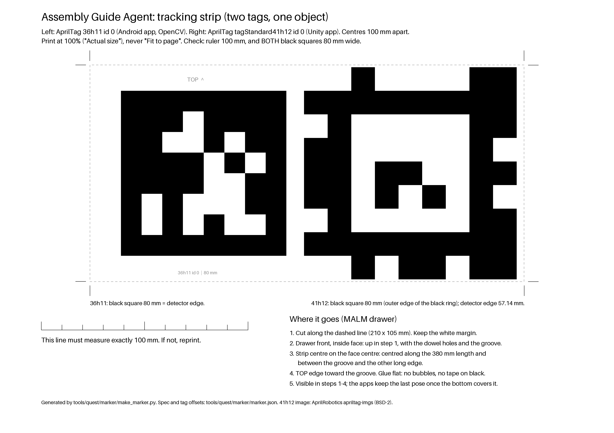

# Quest 3 testing: harness, protocol and judge loop

Shared test harness for the two native Quest 3 apps built in parallel:

| App | Folder | Package | Launch activity |
|---|---|---|---|
| Unity | `quest-unity/` | `com.agj.unity` | detected with `cmd package resolve-activity` (default `com.unity3d.player.UnityPlayerGameActivity`) |
| Android (Kotlin) | `quest-android/` | `com.agj.android` | `.MainActivity` |

Everything lives in `tools/quest/`. Scripts are bash for macOS; analysis is Python (repo `.venv`). Run folders go to `tools/quest/runs/` (git-ignored).

| File | What it does |
|---|---|
| `doctor.sh` | Checks adb, the device, Horizon OS version, Quest Browser, battery, free space, installed apps, permissions, server, key, APKs. Prints what is missing. Exit 0 ready, 1 blocker, 2 no device. |
| `install.sh <unity\|android\|both> [apk] [--replay <dataset>]` | Installs the newest APK (`-r -d -g`), grants `horizonos.permission.HEADSET_CAMERA`, camera and microphone where adb allows, and optionally pushes a replay dataset. |
| `run.sh <unity\|android> [--job J] [--lang el] [--replay] [--hud] [--secs 120]` | Launches with the shared intent extras, records `adb logcat -s AGQ` into `runs/<ts>-<app>/agq.jsonl`, stops after N s or Ctrl-C, then summarizes. |
| `capture.sh <app>` | Screenshot + 10 s clip into the app's latest run folder (`captures/`). |
| `mirror.sh [--eye left] [--record app] [--audio]` | Live headset view on the Mac with scrcpy, optionally recorded. |
| `summarize.py <run_dir>` | `agq.jsonl` → `summary.json` + `summary.md` (latencies, tracking, jitter, fps, steps, errors, gates). |
| `compare.py <run_a> <run_b>` / `--latest` | Side-by-side table of two runs → `runs/<ts>-compare/compare.md`. |
| `round.sh` | The whole protocol below in one command, ending in `judge.md`. |
| `replay/` | Replay datasets, generators, `score_track.py`, `reference_tracker.py`. |
| `marker/` | Printable two-tag strip (36h11 + 41h12) at true size, `marker.json` (tags, offsets, placement), `check_marker.py`. |
| `samples/` | Synthetic AGQ logs (`make_samples.py`) to test the analysis without a headset. |

## 1. One-time setup (15 min, once per Mac / headset)

1. **Developer mode**: Meta Horizon phone app → Devices → the headset → Headset settings → Developer mode ON (needs a verified Meta developer account).
2. **Tools on the Mac**: `brew install --cask android-platform-tools` (adb), `brew install scrcpy` (mirror). Python deps: `.venv/bin/pip install opencv-contrib-python pillow numpy pupil-apriltags pymupdf` (the last two only for 41h12 checks).
3. **USB debugging**: plug in a USB-C *data* cable, put the headset on, accept "Allow USB debugging" with "Always allow from this computer".
4. **Horizon OS v74 or later** (Settings → General → Software update). The Passthrough Camera API needs it, and only Quest 3 / 3S have it. `doctor.sh` reads the version from the `ro.vros.*`/`ro.ovr.*` props when they exist (prop name UNVERIFIED on every OS build); otherwise check Settings → General → About.
5. **Print the marker strip**: `tools/quest/marker/agj-marker-strip-36h11-41h12-id0.pdf` (A4 landscape) at **100 %** ("Actual size", never "Fit to page", no borderless scaling). Then measure with a ruler: the printed ruler is **100 mm**, the left (36h11) black square is **80 mm** wide, and the right (41h12) black square, the solid black ring, is **80 mm** wide. Off by more than 1 mm: fix the print scale and reprint. Cut along the dashed line (210 × 105 mm) and stick it on the drawer front (section 4).
6. **Server**: the demo host must be up (`jobs/_host/url.txt` holds its URL; `doctor.sh` calls `/healthz`). `run.sh` reads the URL and `DEMO_KEY` from `jobs/_host/url.txt` and `.env` (in a worktree it falls back to the main checkout). Overrides: `AGQ_SERVER`, `AGQ_KEY`. The key is never printed or written to run folders.
7. Optional, to keep the headset awake on the desk without wearing it: `adb shell am broadcast -a com.oculus.vrpowermanager.prox_close` (undo with `...automation_disable`; UNVERIFIED on the newest OS).

## 2. The 5-minute round (per build, per human tester)

One command does it all; it pauses before each app so you can put the headset on:

```bash
tools/quest/round.sh                       # doctor -> install both -> Unity 120 s -> Android 120 s -> compare
tools/quest/round.sh --secs 60 --lang en   # shorter, English voice
tools/quest/round.sh --skip-install        # same builds as last round
tools/quest/round.sh --replay marker-synthetic --no-pause   # no human needed: replay frames, scored vs truth
```

Step by step (same thing, if you want control):

| Min | Command | What you do |
|---|---|---|
| 0:00 | `tools/quest/doctor.sh` | Fix anything marked FAIL. |
| 0:30 | `tools/quest/install.sh both` | Nothing; watch for "installed". |
| 1:00 | `tools/quest/run.sh unity --secs 120` | Headset on. Follow the checklist below for 2 min. |
| 3:00 | `tools/quest/run.sh android --secs 120` | Same checklist, same drawer pose at the start. |
| 5:00 | `tools/quest/compare.py --latest` | Read the table; fill in the human checklist. |

Useful during a run: `tools/quest/mirror.sh --record unity` in a second terminal (live view + clip saved into the run), or `tools/quest/capture.sh unity` for a screenshot and a 10 s clip.

Run the apps in alternating order between rounds (Unity first, then Android first next round) so neither always gets the warmer headset and the better-lit table.

## 3. What to look at in the headset (checklist)

Do the same moves in both apps, in this order:

1. **Start (0:00–0:20)**: the app opens on the right job (MALM drawer, 7 steps) without typing anything; the language matches `--lang`.
2. **Identify/locate (0:20–0:40)**: look at the drawer front for 3 s. The app finds the step and places the ghost. Note how long it took.
3. **Ghost alignment on the real drawer**: edges of the ghost on the real panel edges. Estimate the worst offset in mm (the drawer front is 16 mm thick: "half a thickness" ≈ 8 mm). Check from the front and from 90° to the side.
4. **Jitter while walking around**: walk a half circle around the table at 1 m, then stand still for 5 s. Does the ghost swim, lag, or jump when the marker leaves view? Does it stay put when the marker is hidden (hand over it for 3 s)?
5. **Move the drawer**: slide the front 10 cm and turn it 30°. The ghost should follow within ~1 s (marker tracking) or stay anchored (two-corner fallback), never fly away.
6. **Step auto-advance**: do step 1 for real (dowels in). Does the app advance on its own? If not, press the button and note it (the log records `via`).
7. **Voice**: is the instruction spoken, in the right language, not cut off, not repeated, audible over the room?
8. **Comfort**: frame drops, flicker, UI readable at arm's length, hands not hidden by UI.

Write findings in the "Human checklist" at the end of `judge.md` (round.sh creates it) as `unity / android` pairs, e.g. `Ghost: 5 mm / 15 mm`.

## 4. Marker placement on the MALM drawer



One printed strip carries two AprilTags, one per app's detector. Both apps track the same object, the **strip centre**, so their poses are directly comparable. Machine-readable spec (sizes, offsets, placement): `tools/quest/marker/marker.json`. Regenerate with `make_marker.py`; `check_marker.py` renders the PDF and re-detects both tags (last run: 36h11 edge 79.98 mm at (−50.00, 0.00) mm; 41h12 edge 57.16 mm at (+50.03, −0.04) mm; tolerance 0.3 mm).

| Tag | Detector | `size_m` (detector edge) | What that edge is | Black square | Centre offset from strip centre (`offset_m`) |
|---|---|---|---|---|---|
| AprilTag 36h11 id 0 (`tag36h11_0`) | Android: OpenCV aruco `DICT_APRILTAG_36h11` | 0.08 | outer edge of the black square (8 × 8 modules of 10 mm incl. the black border) | 80 mm | (−0.05, 0, 0) |
| AprilTag tagStandard41h12 id 0 (`tag41h12_0`) | Unity: `jp.keijiro.apriltag` (apriltag C library) | 0.0571429 | **inner** edge of the black ring: 5 of the 9 modules (module 80/7 mm) | 80 mm (7 modules, outer edge of the black ring) | (+0.05, 0, 0) |

- **Why 41h12 is not 80 mm at the detector edge**: its quad is the inner edge of the black ring, and the outermost ring of modules is data. An 80 mm detector edge needs a 144 mm tag, which does not fit the 130 mm drawer front or the 100 mm centre spacing. So the 41h12 is sized by its 80 mm black square (easy to check with a ruler), and its `size_m` is 0.0571429. The Unity app must pass that value as the tag size. The 41h12 image is the official AprilRobotics `apriltag-imgs` `tagStandard41h12/tag41_12_00000.png` (BSD-2, kept in `marker/vendor/`), upscaled nearest-neighbour.
- **Marker axes** (strip axes, right-handed, metres): origin at the strip centre; x along the strip from the 36h11 to the 41h12 tag; y toward the **TOP** edge; z out of the printed face. Both tags are upright, so each tag's axes are parallel to the strip's (`offset_q` = identity), and the object pose is `T_cam_strip = T_cam_tag · Translation(−offset_m)`, i.e. `p_strip = p_tag − R_tag · offset_m`.
- **apriltag-library axes**: the apriltag C library (also `jp.keijiro.apriltag`, `pupil-apriltags`) returns tag poses with x right, y **down**, z **into** the tag. Convert with `R_marker = R_apriltag · diag(1, −1, −1)` before applying the offset. Its corners come in the order bottom-left, bottom-right, top-right, top-left; OpenCV aruco's order is top-left, top-right, bottom-right, bottom-left. OpenCV already uses marker axes. Checked on `marker-synthetic`: the converted 41h12 pose matches the truth within 1 mm and 0.3°.
- **Part**: the drawer front (380 × 130 × 16 mm), **inside face**: the face that is up in step 1, with the dowel holes and the groove for the drawer bottom.
- **Position**: the strip centre goes where the single tag's centre used to be: centred along the 380 mm length, and centred between the groove and the opposite long edge. The 210 × 105 mm strip fits; keep the groove and the dowel holes clear.
- **Orientation**: the printed **TOP** edge points toward the groove, and the strip runs along the 380 mm length. Each app turns the strip pose into its model frame with one constant offset; log it once in the `start` event.
- **Fixing**: flat, without bubbles (glue stick or low-tack spray). Tape only on the white margin. The 41h12's outer data modules come within 1 mm of the top and bottom cut lines: cut on the line, not inside it.
- **Visibility**: steps 1–4. When the bottom panel slides in, the marker is covered: apps must hold the last good pose (anchor) and say so in `track.source`.

## 5. Contracts the apps implement

### Launch extras

`server` (string), `key` (string), `job` (string), `lang` (`el`|`en`), `replay` (bool), `hud` (bool). `run.sh` sends:

```bash
adb shell am start -S -W -n <activity> --es lang el --es job malm-drawer --ez replay false --ez hud false \
  --es server <url from jobs/_host/url.txt> --es key <DEMO_KEY from .env>
```

### AGQ log lines

Logcat tag `AGQ`, one JSON object per line: `{"t", "app", "ev", ...}`. `t` may be epoch seconds or ms. Fields `summarize.py` reads (others are kept in the log but ignored):

| `ev` | Fields used | Recommended extras |
|---|---|---|
| `start` | first one is t = 0 | `ver`, `lang`, `replay`, `tag` (key from `marker.json`), model-from-strip offset |
| `job_loaded` | `job`, `steps` | `ms` |
| `identify`, `locate` | `ms` (or `latency_ms`), `ok`, `next_step`/`step` | |
| `track` (1 Hz) | `fps`, `tracked`, `pos_m` [x,y,z], `yaw_deg`, `reproj_px`, `source` | `q` [x,y,z,w]; in replay mode: `frame` (int replay frame index). Pose = strip centre, see below |
| `perception` | `kind` (or `type`) | |
| `step` | `n`, `via` (`auto`, `button`, `voice`, ...) | `prev` |
| `frame` | `bytes`, `ms` | |
| `error` | `msg` | |

`fps` is the app's render frame rate. `pos_m` is the assembly position (the strip centre) in the app's world. Keep each line under ~4 KB (logcat truncates longer ones).

**`track` pose fields** (what `score_track.py` reads):

| Field | Type, unit | Meaning |
|---|---|---|
| `pos_m` (alias `pos`) | [x, y, z], metres | Strip-centre position. In live mode and in replay "world" mode it is in the app's world. In replay "camera" mode it is in the camera frame. |
| `q` (aliases `rot`, `quat_xyzw`, `quat_wxyz`) | unit quaternion | Strip orientation (marker axes, section 4) in the same frame as `pos_m`. **Canonical order `[x, y, z, w]`.** `[w, x, y, z]` is accepted: name the field `quat_wxyz`, add `"q_order": "wxyz"`, or pass `--q-order wxyz`; by default the scorer tries both and keeps the one that fits. |
| `frame` | integer | Replay frame index (the `frame` of the `poses.jsonl` line used). Strongly recommended in replay mode: it makes scoring independent of the playback fps. It is never a string. |
| handedness | | Android logs right-handed Y-up (OpenXR, same as `poses.jsonl`). Unity logs Unity's left-handed Y-up values as they are (`transform.position`, `transform.rotation`). Score those with `--unity` (`round.sh` adds it for the unity app): the scorer mirrors them back with `(x, y, z) → (x, y, −z)` and `q (x, y, z, w) → (−x, −y, z, w)`. In Unity the strip's local axes are then x along the strip, y to TOP, z **into** the face (the mirror of "out of the face"). |

### Replay datasets

On the device: `/sdcard/Android/data/<pkg>/files/replay/` holds JPEG frames (`000000.jpg`, ...), `intrinsics.json` (`fx, fy, cx, cy, width, height` in pixels of these JPEGs, plus `fps` and `distortion: null`), and optionally `poses.jsonl`. `install.sh <app> --replay <dataset>` pushes one (it clears the folder first). With `--replay`, `run.sh` sends `replay=true`; the app should then read frames from that folder instead of the passthrough camera, ideally at the dataset `fps`. If it plays at another rate, log `frame` in `track` events.

| Dataset | Size | In git | Use |
|---|---|---|---|
| `malm-drawer-renders/` | 7 frames, 768 × 768, 117 KB | yes | identify/locate and step logic: frame N should come back as step N (`dataset.json` → `frame_list[].expected_step`). Blender renders on white, plausible intrinsics (50° FOV), no poses. Rebuild: `.venv/bin/python tools/quest/replay/make_malm_renders.py`. |
| `marker-synthetic/` | 300 frames, 1280 × 960, 30 fps, ~23 MB | no (generated) | tracker accuracy and jitter against ground truth. Generate: `.venv/bin/python tools/quest/replay/make_marker_synthetic.py` (~10 s). |

`marker-synthetic` renders the printed strip (same drawing code, both tags fully in view in every frame) on a wood table, with lighting drift, vignetting, blur and sensor noise. The smallest detector edges are 87 px (36h11) and 73 px (41h12). Trajectory: frames 0–179 orbit (azimuth −55°…+55°, 0.55 m), 180–259 slow sideways move and approach to 0.42 m, 260–299 perfectly still (the jitter window). The **strip centre** lies face up at the **world origin**, TOP edge toward world −Z, strip x along world +X (world-from-strip quaternion `[−0.7071068, 0, 0, 0.7071068]`). `dataset.json` repeats the conventions and the tags list from `marker.json`.

#### `poses.jsonl` (canonical format, defined by the tools)

One JSON object per line, one line per frame, in frame order. Every quaternion is a Hamilton unit quaternion in **`[x, y, z, w]`** order with `w ≥ 0`. All positions are in metres. The **world** is right-handed, Y up (OpenXR).

| Field | Type | Meaning |
|---|---|---|
| `frame` | int | Frame index, 0-based (= line number). |
| `t` | float, s | `frame / fps`. |
| `file` | string | JPEG name, e.g. `"000000.jpg"`. Match by this field, or by `frame`. |
| `cam_p` | [x, y, z] | **World-from-camera** translation: the camera centre in the world. |
| `cam_q` | [x, y, z, w] | **World-from-camera** rotation, with **OpenCV camera axes** (x right, y down, z forward): `p_world = R(cam_q) · p_cam + cam_p`. |
| `cam_q_xr` | [x, y, z, w] | The same camera rotation with **OpenXR camera axes** (x right, y up, z backward): `cam_q_xr = cam_q · (180° about x)`. Same `cam_p`. |
| `marker_p` | [x, y, z] | **Camera-from-object** translation: the strip centre in the OpenCV camera frame. This is what PnP returns after the tag offset. |
| `marker_q` | [x, y, z, w] | **Camera-from-object** rotation: the strip's marker axes in the OpenCV camera frame. `p_cam = R(marker_q) · p_strip + marker_p`. |
| `tag_corners_px` | {tag key: [[u, v] × 4]} | Each tag's detector-edge corners in pixels (pixel centres at integers): top-left, top-right, bottom-right, bottom-left of the upright tag. Keys are `tag36h11_0` and `tag41h12_0` from `marker.json`. |

How each reader uses it:

- **Android** (right-handed, OpenCV pipeline): camera pose = `cam_p` + `cam_q` (WORLD ← CAMERA, OpenCV axes). Read these two keys; the current reader looks for `pos_m`/`quat_xyzw`/`p`/`q`, which are not in the file. Then the strip in the world is `T_world_cam · T_cam_strip` and should come out as the origin with `[−0.7071068, 0, 0, 0.7071068]`.
- **Unity** (left-handed): camera pose = mirror of (`cam_p`, `cam_q_xr`): `position = (x, y, −z)`, `rotation = (−qx, −qy, qz, qw)`. That gives a Unity camera with +z forward and +y up. The current reader looks for `pos`/`rot` and a string `"frame"`, which are not in the file. Here `frame` is an int and the file is always OpenXR/OpenCV, never Unity.
- An app that uses the dataset camera poses should report `pos_m ≈ (0, 0, 0)` and `yaw_deg ≈ 0` in every frame, whatever its handedness.

**Scoring**: `tools/quest/replay/score_track.py <run_dir> --dataset marker-synthetic [--unity] [--q-order auto|xyzw|wxyz]` matches `track` events to frames (by `frame`, else by time with the best offset within ±2 s). It tries both interpretations (world frame vs camera frame with OpenCV/Unity/OpenXR camera axes), keeps the best, and writes `score.json` + `score.md`: position error p50/p90/max, bias, still-phase jitter, yaw error, rotation error (when `q` is logged; world: against the strip's world orientation; camera: against `marker_q` in OpenCV or OpenXR camera axes), and frame coverage.

**Baselines** (`reference_tracker.py`: detection + IPPE PnP + tag offset → strip centre, on the Mac, measured 15 Nov 2026, world frame, 300/300 frames detected):

| Tag | Position error p50 / p90 | Still jitter | Yaw err p50 | Rotation err p50 |
|---|---|---|---|---|
| 36h11 (OpenCV, default) | 1.27 / 2.23 mm | 0.03 mm | 0.02° | 0.10° |
| 41h12 (`--tag 41h12`, pupil-apriltags) | 0.81 / 1.19 mm | 0.04 mm | 0.03° | 0.07° |

An app tracker on the same frames should land within a few mm of these. Much worse means a bug (intrinsics, axes, tag size, offset), not "hard frames". The two tags agree to about 1 mm, so a constant gap between the two apps is an offset or axes bug.

```bash
.venv/bin/python tools/quest/replay/reference_tracker.py              # -> runs/reference-marker-synthetic/
.venv/bin/python tools/quest/replay/reference_tracker.py --tag 41h12  # -> runs/reference-marker-synthetic-41h12/
.venv/bin/python tools/quest/replay/score_track.py tools/quest/runs/reference-marker-synthetic
# test the scorer: a fake Unity log (left-handed, camera frame, q as wxyz), scored back
.venv/bin/python tools/quest/replay/score_track.py --make-fake /tmp/fake.jsonl --frame camera --noise-mm 2 --unity --fake-q wxyz
.venv/bin/python tools/quest/replay/score_track.py /tmp/fake.jsonl --unity
```

## 6. Captures: what works on Quest

- `adb exec-out screencap -p` and `adb shell screenrecord` capture the compositor's eye buffer. Expect both eyes side by side with lens distortion, and **often a black passthrough layer** (camera images are kept out of captures for privacy). `capture.sh` measures the screenshot's brightness and warns when it is black; if `screenrecord` fails it falls back to scrcpy.
- For a faithful live view use **scrcpy**: `tools/quest/mirror.sh` (crops one eye; `--eye both` for the full buffer; `--record unity` saves an mp4 into that app's run folder; `--audio` forwards the voice). Casting from the Meta Horizon phone app or Meta Quest Developer Hub also shows passthrough and is the best option for demo video.
- The run log is the primary evidence; video is for humans.

## 7. How results reach the judge

Each run folder `tools/quest/runs/<YYYYmmdd-HHMMSS>-<app>/` contains:

| File | Content |
|---|---|
| `agq.jsonl` | Raw AGQ events, one per line. |
| `logcat.txt` | Errors from all tags + `AndroidRuntime`, `Unity`, native crash lines. |
| `meta.json` | App, version, activity, extras (no key), device fingerprint, repo commit, launch time. |
| `summary.json` / `summary.md` | Metrics and gates (pass / fail / no data). |
| `score.json` / `score.md` | Replay runs only: accuracy against ground truth. |
| `captures/` | Screenshots and clips. |

`round.sh` (or `compare.py`) writes `tools/quest/runs/<ts>-compare/` with `compare.md`, `compare.json` and `judge.md`. **`judge.md` is the one file to hand to the judge agent**: comparison table, both summaries, replay scores, capture list and the human checklist. The judge should read gates first, then the metrics that differ most, then the human notes, and answer with concrete fixes per app.

Gates (edit `GATES` in `summarize.py`): job loaded ≤ 10 s, identify p50 ≤ 4 s, locate p50 ≤ 6 s, tracked ≥ 80 % of the time, reprojection p50 ≤ 3 px, still jitter p50 ≤ 3 mm, fps p5 ≥ 60, no errors, no crashes. Jitter is the RMS distance from the mean over 2 s windows of tracked samples whose positions span ≤ 2 cm (wider windows count as "moving" and are excluded).

Run folders are git-ignored. To share a round, paste or attach `judge.md`; attach the run folder only when the judge asks for raw events.

## 8. Testing the harness without a headset

```bash
.venv/bin/python tools/quest/samples/make_samples.py            # writes samples/agq-sample*.jsonl
.venv/bin/python tools/quest/summarize.py tools/quest/samples/agq-sample.jsonl
.venv/bin/python tools/quest/compare.py tools/quest/samples/agq-sample.jsonl tools/quest/samples/agq-sample-android.jsonl
tools/quest/doctor.sh                                            # without a device: "NO DEVICE", exit 2
```

The shell scripts honour `ADB=/path/to/adb`, so a fake adb can drive `run.sh` end to end.

## 9. Troubleshooting

| Symptom | Fix |
|---|---|
| `doctor.sh`: unauthorized | Put the headset on, accept the USB debugging prompt. |
| `INSTALL_FAILED_UPDATE_INCOMPATIBLE` | `install.sh` uninstalls and retries (the app's data is lost). |
| `agq.jsonl` is empty | The app does not log with tag `AGQ`, or the line is not JSON. Check `adb logcat -s AGQ` by hand. |
| Permission grant fails | Some Horizon permissions are not adb-grantable on every OS build; accept the prompt in the headset once. |
| Replay push fails | Start the app once so Android creates `/sdcard/Android/data/<pkg>/files/`, then rerun `install.sh --replay`. |
| Several devices | `export ANDROID_SERIAL=<serial>`. |
| Wi-Fi instead of USB | `adb tcpip 5555 && adb connect <quest-ip>:5555`, then unplug. |

## 10. Markerless tracking (offline research, not in the apps)

`tools/markerless/` is an offline Python study of whether the marker can be dropped. It renders 360 synthetic Quest-like frames of the drawer at steps 1, 2, 4 and 5 (Blender), and tracks the drawer with oriented-chamfer edge tracking against the step's mesh, constrained to the table plane. Results are in `tools/markerless/REPORT.md`:

- Edge tracking: 84% of frames within 10 mm and 5°, p50 4.6 mm and 0.5°, about 43 ms per frame on an M4 core in Python.
- Keypoints on the white panels: 0%.
- The marker: p50 1.35 mm.

Keep the marker for the demo. Edge tracking is the candidate for when the marker is covered (step 4 onwards), seeded by the marker or the two-corner touch. Before any app work, validate it on a real replay with the marker pose as ground truth: `eval_edges.py` takes `frames.jsonl` (K, `T_world_cam`, `T_world_obj`) plus `img/`.
