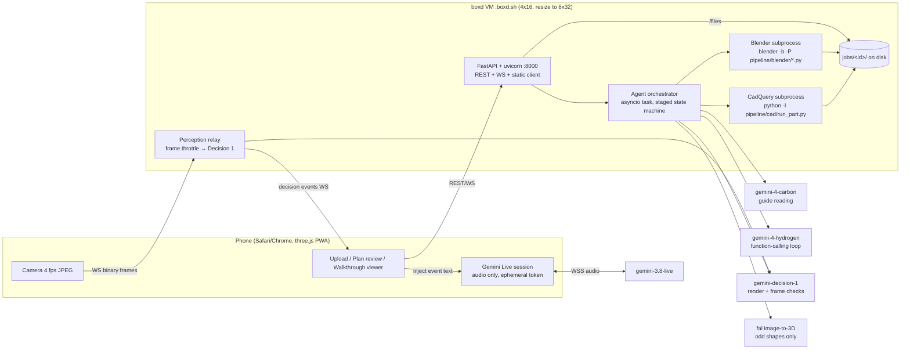

# Backend, infrastructure, repo, team and schedule

Owner: backend/infra lead. Status: plan for Sat 14 Nov 2026, 20:00, through code freeze Sun 15 Nov 18:00 (Athens time).

**Key decisions**
1. One FastAPI process does everything. It runs on **one boxd VM (primary)**, and the same code runs on a MacBook through a cloudflared tunnel as the fallback.
2. CadQuery and Blender run as **subprocesses, one job at a time**. There is no Redis and no queue.
3. **Python 3.13**, because the `bpy` 5.3 wheel requires it. Blender itself runs as a separate binary, so the server is not tied to that version.
4. The phone gets everything from one HTTPS origin: the static client, REST, WebSockets and the ephemeral token.
5. Every agent step is appended to `events.jsonl`. That file is the source of truth for both the UI feed and debugging.

---

## 1. Architecture



How perception events reach the voice agent: the Live session is opened **on the phone**, using an ephemeral token minted by the backend. The backend pushes decision events down the frames WebSocket. The phone forwards **only state changes**, such as `step 4: dowel missing in hole B`, into the open Live session as a text turn. The voice model never sees raw frames, and the server never touches audio. Section 2 has the exact client call, which belongs to the phase-2 owner.

## 2. Backend stack and API

| Choice | Decision | Why |
|---|---|---|
| Language | Python **3.13** (not 3.11) | `bpy` 5.3.0 on PyPI pins `Python ==3.13.*`, with wheels for macOS arm64 and Linux x86-64 but none for Linux aarch64 (https://pypi.org/project/bpy/). `cadquery-ocp` 8.0.1.1.0 supports 3.11–3.14 on macOS arm64, Linux x86-64 and Linux aarch64 (https://pypi.org/project/cadquery-ocp/). |
| Blender invocation | Official Blender binary, `blender -b --factory-startup -P script.py -- args.json` | Crash isolation, timeouts, and the same command on macOS and Linux. Keep `pip install bpy` only as the in-process fallback. |
| Web | FastAPI + uvicorn (`uvicorn server.app:app --host 0.0.0.0 --port 8000`) | Native WebSockets (https://fastapi.tiangolo.com/advanced/websockets/). Port 8000 is boxd's default proxied port (https://docs.boxd.sh/guides/https.md). |
| Gemini | `google-genai` ≥3.2 (Decision 1 needs the v1beta Decisions API) | Single SDK for all models. |

**REST endpoints** (all under `/api`, all require the header `X-Demo-Key: $DEMO_KEY`)

| Method | Path | Request | Response |
|---|---|---|---|
| POST | `/api/jobs` | multipart `file=guide.pdf` | `{job_id, status:"ingesting"}` |
| GET | `/api/jobs/{id}` | – | `{job_id, stage, status, progress:0..1, error?, last_seq}` |
| GET | `/api/jobs/{id}/plan` | – | `plan.json` (schema owned by the agent section) |
| POST | `/api/jobs/{id}/plan/approve` | `{approved:true, plan?:<edited plan>, note?:str}` | `{stage:"building"}` |
| GET | `/api/jobs/{id}/artifacts` | – | `{walkthrough_glb, steps:[{index, anim_name, crop_url, render_url, check:{ok,score}}], parts:[...]}` |
| GET | `/files/{id}/{path}` | – | static file from `jobs/{id}/` |
| POST | `/api/jobs/{id}/retry` | `{from_stage:"parts"\|"scene"\|...}` | `{stage}` |
| POST | `/api/live/token` | `{job_id}` | `{token, expires_at, model:"gemini-3.8-live"}` |
| GET | `/healthz` | – | `{ok, blender_version, cadquery_ok, job_running}` |

**WebSockets**

| Path | Direction | Messages |
|---|---|---|
| `/ws/jobs/{id}/events?since=<seq>&key=` | server→phone | On connect, replays `events.jsonl` from `seq`, then tails it. Event: `{seq, ts, stage, type:"stage"\|"thought"\|"tool_call"\|"tool_result"\|"image"\|"approval_required"\|"error"\|"done", text?, tool?, args?, ok?, image_url?, ms?}` |
| `/ws/sessions/{job_id}/perception?key=` | both | Phone→server: text `{type:"step", index}` when the user changes step. Binary JPEG frames (640 px long edge, quality 0.6, about 30–50 KB). Server→phone: `{type:"decision", step, state:"ok"\|"wrong_part"\|"wrong_orientation"\|"missing"\|"unclear", message, confidence, latency_ms, frame_ts}` |

Perception throttle: allow **at most 2 Decision 1 requests in flight**, drop stale frames (keep only the newest), and only emit an event to the client when `state` changes or the same state persists for 3 consecutive frames (debounce). At 4 fps one phone uses **240 RPM**, which is above the Free tier's 200 RPM. **Billing Tier 1 (1,500 RPM / 50,000 RPD) is mandatory.** 50,000 RPD covers about 208 minutes of streaming at 4 fps, which is enough for dev, eval and the demo, but eval replays must be rationed.

Ephemeral token minting. The pattern is from https://aistudio.google.com/docs/live-api/ephemeral-tokens: v1beta only, a 1-minute window to start a session, 30 minutes per token, and session resumption is needed to reconnect about every 10 minutes.

```python
client = genai.Client(http_options={"api_version": "v1beta"})
now = datetime.datetime.now(tz=datetime.timezone.utc)
token = client.auth_tokens.create(config={
    "uses": 1,
    "expire_time": now + datetime.timedelta(minutes=30),
    "new_session_expire_time": now + datetime.timedelta(minutes=1),
    "live_connect_constraints": {"model": "gemini-3.8-live",
        "config": {"response_modalities": ["AUDIO"], "session_resumption": {},
                   "system_instruction": VOICE_PROMPT}},   # prompt stays server-side
})
return {"token": token.name, "expires_at": ...}
```

The phone then calls `new GoogleGenAI({httpOptions:{apiVersion:"v1beta"}, apiKey: token.name}).live.connect(...)`. The text-injection call used for perception events (`session.sendClientContent` or `sendRealtimeInput({text})`) is **UNVERIFIED for 3.8 Live**. The phase-2 owner checks it first thing Sunday.

## 3. Job orchestration

**Recommendation: no Redis/RQ.** There is one demo, one job at a time and one process. Use an `asyncio.Lock` per server, and run each job as an `asyncio.Task`. Heavy work goes through `asyncio.create_subprocess_exec` with `asyncio.wait_for(timeout)` and is killed with `proc.kill()` when it times out. Redis would add a daemon and failure modes without changing anything we can demo.

Every stage is **idempotent**:
- A stage writes its outputs to temp files, renames them atomically, then writes `stages/<stage>.done` containing `{input_sha256, finished_at}`.
- On (re)start, a stage is skipped if its marker exists and the input hash matches.
- `POST /retry {from_stage}` deletes the markers from that stage onward.
- A server crash therefore loses at most the current tool call.

Disk layout (`JOBS_DIR=/srv/agj/jobs`, or `./jobs` locally):

```
jobs/<job_id>/
  guide.pdf
  pages/page-001.png ...        # 200 dpi rasters (pypdfium2)
  crops/step-01.png ...         # guide crops per step (shown on phone)
  plan.json  plan.approved.json
  parts/<part_id>.py  .step  .glb  .stl
  renders/part-<id>-iso.png  step-03.png  check-*.json
  scene.py  scene.blend
  walkthrough.glb               # one animation (NLA track) per step: "step_01".."step_NN"
  events.jsonl                  # append-only, one JSON event per line, fsync per write
  stages/*.done  logs/*.stderr
```

## 4. Agent orchestrator

The orchestrator is a staged state machine. The Hydrogen loop runs only inside the build stages.

```
INGEST → EXTRACT_PLAN (Carbon) → AWAIT_APPROVAL ⏸ → PARTS → SCENE → ANIMATE → CHECK → EXPORT → DONE
```

- **Approval checkpoint**: `AWAIT_APPROVAL` emits `approval_required` and waits on an `asyncio.Event` that `POST /plan/approve` sets. There is no timeout. The approved, possibly edited, plan is written to `plan.approved.json`, and it is the only plan the build stages read.
- **Tool registry**: a dict of `name → (FunctionDeclaration, async handler, timeout_s)`.

| Tool | Handler | Timeout |
|---|---|---|
| `get_plan()`, `get_guide_page(n)`, `get_step_crop(i)` | read disk (images are returned as parts) | 5 s |
| `write_part(part_id, code)` | save `parts/<id>.py`, run CadQuery in a subprocess, export STEP/GLB, render iso PNG | 90 s |
| `check_part(part_id)` | Decision 1: part render vs guide drawing → `{ok, issues}` | 30 s |
| `generate_odd_part(part_id, crop)` | fal image-to-3D → GLB (only when CadQuery fails 3×) | 180 s |
| `write_scene_script(code)` / `run_blender(script)` | Blender subprocess; returns stdout tail + error | 240 s |
| `render_step(i)` | Blender still of the end pose of step i | 120 s |
| `check_step(i)` | Decision 1: render vs guide crop | 30 s |
| `export_walkthrough()` | GLB export plus validation that the animation count equals the step count | 120 s |
| `finish(summary)` | ends the loop | – |

- **Loop**: manual function calling, with `automatic_function_calling` disabled so that every call can be logged. The limits are:
  - `MAX_ITERS=60` for the whole build
  - `MAX_ATTEMPTS_PER_PART=4`, after which the part is marked `fallback:box` with its dimensions and the agent moves on
  - a wall budget of **40 min per job**
  - two consecutive identical tool calls raise an error back to the model
- **Feeding images back**: every tool returns `{"result": {...json...}}` as a `function_response` part. The **image is attached as an extra `Part.from_bytes(png, "image/png")` in the same user turn**, right after the function responses. Native multimodal function responses for Hydrogen are **UNVERIFIED**, so we use the extra-part pattern that works regardless.
- **Context control**: only the last 2 renders stay as images in history. Older ones are replaced with the text `[image renders/part-x.png omitted]`.
- **Logging**: every model turn (thought summary text), tool call (name, args with the code truncated to 400 chars plus a link to the file), tool result (ok, ms, error tail) and image is appended to `events.jsonl` before anything else happens. The WebSocket simply tails this file. The UI feed and the post-mortem are the same data.

## 5. Where heavy work runs

boxd facts:
- Sizes are **1x4, 2x8 (default), 4x16, 8x32** (vCPU x GiB) (https://docs.boxd.sh/guides/resources.md).
- The OS is Ubuntu 24.04 with systemd and Docker preinstalled (https://boxd.sh/llms.txt).
- Every machine has a public HTTPS URL, and WebSockets "work transparently" (https://docs.boxd.sh/guides/https.md).
- Machines auto-hibernate after 4 h with no network traffic, with a wake time of about 85 ms (resources page).
- Resizing reboots the machine, but the disk persists.
- Pricing is €0.039 per active vCPU-hour and €0.012 per GiB-hour of RAM (https://boxd.sh/llms.txt). An 8x32 VM costs at most about €0.70/h, so the €50 credits are not a constraint.

The docs say nothing about a GPU, so **assume no GPU**. CPU architecture is also not documented and is **UNVERIFIED**. Run `uname -m` first: official Blender Linux builds and the bpy wheel are x86-64 only, while CadQuery also has aarch64 wheels.

| | Primary: boxd VM `agj` (4x16, resize to 8x32 for the demo) | Fallback: MacBook Air M4 + cloudflared |
|---|---|---|
| Blender | Linux x86-64 tarball from blender.org. **Renders with Cycles CPU** (64 samples, 960 px, denoise). EEVEE/Workbench without a GPU need an OpenGL/EGL context, which is UNVERIFIED headless. | macOS arm64 build, EEVEE on Metal. Also the place to run blender-mcp for interactive debugging. |
| HTTPS | `https://agj.boxd.sh`, built in | `cloudflared tunnel --url http://localhost:8000` gives a random `trycloudflare.com` URL (UNVERIFIED that it is still offered without an account) |
| Demo risk | Independent of laptop sleep and venue Wi‑Fi on the server side | Laptop must stay awake (`caffeinate -dims`) and online |

**Go/no-go for boxd (by 21:30 Sat)**:

```bash
boxd machine new agj
boxd machine exec agj -- uname -m
boxd machine exec agj -- bash -lc 'curl -LO <blender-linux-x64 tarball> && tar xf ... && ./blender -b --python-expr "import bpy;bpy.ops.render.render(write_still=True)"'
```

This must produce a PNG in under 60 s. If it does not, the MacBook becomes primary and boxd hosts only the API and the static client, reaching the Mac via an outbound worker.

Notes on hosting the client and demo networking:
- **Client hosting**: build `/client` with Vite and serve `client/dist` from FastAPI on the same origin. That gives the secure context for the camera, no CORS, and one URL to put in a QR code.
- We also deploy the static client to Vercel as a mirror. `VITE_API_BASE` points it at the boxd URL, and CORS allows that origin. Vercel Functions are not used: they have a 300 s maximum on Hobby, a 4.5 MB body limit and 2 GB of memory (https://vercel.com/docs/functions/limitations).
- **Demo networking**: the demo phone uses **its own 4G/5G data** and is never on venue Wi‑Fi. A second phone is a hotspot for the laptop. The server is in a boxd region, Frankfurt (https://docs.boxd.sh/guides/regions.md). Phase-2 uplink is about 4 × 40 KB = 160 KB/s.

## 6. Secrets

- The **server** `.env` holds `GEMINI_API_KEY`, `FAL_KEY`, `BOXD_API_KEY` (CLI/SDK only), `DEMO_KEY`, `JOBS_DIR` and `TREG_TOKEN` (optional). It is loaded with `pydantic-settings`.
- `.env.example` is committed. `.env`, `jobs/`, `*.blend1`, `client/dist`, `eval/clips/*.mp4` and `.venv/` go in `.gitignore`.
- The **client** never sees `GEMINI_API_KEY`. It only gets the 30-minute single-use ephemeral token. `/api/live/token` is limited to 1 request per 10 s per IP.
- The `.env` is copied to the VM with `boxd machine cp .env agj:/srv/agj/.env`.
- Because the boxd URL is **public**, every route checks `DEMO_KEY`, and the QR code embeds `?key=`. This protects Gemini spend.
- Before the first push, run `gitleaks detect` or `git grep -n "AIza"`.

## 7. Repo layout and conventions

```
/client      Vite + three.js PWA (upload, plan review, walkthrough, live feed, phase-2 camera/voice)
/server      app.py, routes/, orchestrator/, tools/, perception/, settings.py
/pipeline    cad/run_part.py, cad/lib.py (dowel/cam-lock helpers)
             blender/scene.py, animate.py, render_step.py, export_glb.py
/prompts     carbon_extract_plan.md, hydrogen_build_system.md, decision_part_check.md, decision_frame_check.md, live_voice.md
/eval        golden/<guide>/{guide.pdf,expected_plan.json}, score_plan.py, smoke.sh, phase2/{clips/,labels.json,replay.py}
/docs        architecture.md, demo-script.md
CREDITS.md   README.md   .env.example   Makefile (dev, smoke, deploy-box)
```

Conventions:
- Python is formatted with `ruff`, and the JS client with Prettier.
- Pipeline scripts take one JSON args file and print one JSON line (`RESULT {...}`) on success. The tool handlers parse that line.
- Prompts are files, never inline strings, and the version is logged in events.
- Work goes on short-lived branches with squash-merges to `main`. `main` always passes `make smoke`.
- **Credits**: `CREDITS.md` lists every third-party repo, snippet, model and asset with its URL and license. Examples are blender-mcp, three.js examples, CadQuery examples and the guide PDFs, with each guide's manufacturer and the note "used for demo only". Copied files keep a header comment `# Adapted from <url> (<license>)`.

## 8. Testing

| Test | What | Pass criterion |
|---|---|---|
| Golden guide | 1 simple guide (≤8 parts, ≤10 steps) plus a hand-written `expected_plan.json` | `score_plan.py`: part-type recall ≥0.9, quantities exact for ≥80 % of parts, step-order Kendall τ ≥0.8 |
| Smoke | `eval/smoke.sh BASE KEY`: healthz → upload golden → wait `approval_required` → approve unchanged → poll ≤40 min → GLB has `N_steps` animations (checked with `npx @gltf-transform/cli inspect`) | Exit 0. Run before every merge to main after 02:00 and before recording. |
| Pipeline unit | `run_part.py` on 3 fixture scripts; `export_glb.py` on a fixture scene | Runs in under 30 s |
| Phase 2 offline | 10–15 phone clips of the golden furniture, labelled per second with `{step, state}`. `replay.py` streams them at 4 fps through the real WS route. | Step-state accuracy ≥70 %, false-alarm rate ≤1 per minute on "ok" clips, p50 Decision latency ≤250 ms and p95 ≤600 ms, frame-to-phone event p50 ≤500 ms |

Phase 1 metrics to log per job: wall time per stage, Hydrogen iterations, CadQuery success rate on the first attempt, `check_part` and `check_step` pass rates, token and request counts, and estimated €.

## 9. Team and schedule

| Person | Role | Owns |
|---|---|---|
| **A** (infra lead) | Backend and infra | FastAPI, WS, orchestrator skeleton, boxd, deploy, smoke, CREDITS |
| **B** | Agent and prompts | Carbon plan extraction, Hydrogen loop, tool schemas, golden plan eval |
| **C** | CAD and Blender | CadQuery helpers, Blender scene/animate/export scripts, blender-mcp debugging |
| **D** | Phone client | three.js viewer, plan review UI, live reasoning feed, QR/PWA |
| **E** | Phase 2 and story | Decision 1 frame checks, Live voice, clip recording; owns the video and pitch from 13:00 Sun |

**First hour checklist (20:00–21:00)**:
- Everyone gets AI Studio access. **A** creates the project, **links billing and confirms Tier 1** (needed for 1,500 RPM on Decision 1), creates `GEMINI_API_KEY`, and smoke-calls each model id.
- boxd: each person runs `boxd auth login`. **A** adds a payment method, because without one the org is capped at 2 machines, then creates the `agj` VM and runs the go/no-go above.
- fal: create `FAL_KEY` and pick one image-to-3D model from its `llms.txt`.
- treg: create a token (optional, for prize eligibility).
- Vercel: link the `/client` project.
- On the Macs, install `uv`, Python 3.13 and Blender 5.x for macOS arm64 (for C and A), then `uv pip install cadquery google-genai fastapi uvicorn[standard] pypdfium2`. Install `cloudflared` with brew.
- Choose the golden guide by 20:30, and have **B** start `expected_plan.json` by hand.
- Push the repo skeleton, `.gitignore`, `.env.example` and `CREDITS.md`.

| Time | A | B | C | D | E |
|---|---|---|---|---|---|
| Sat 21–24 | API + WS + events.jsonl, deploy to boxd | Carbon → plan.json on golden | CadQuery runner + 3 parts; Blender headless on boxd | Upload, plan review, events feed | Decision 1 hello-world on photos; Live token flow |
| **00:00** | **GO/NO-GO Phase 1**: golden guide → walkthrough.glb with ≥3 animated steps viewed on phone (hand-fixed plan allowed). No-go means C+B cut scope to boxes-only parts and E joins phase 1. | | | | |
| 00–03 | Integrate loop, retries | Hydrogen loop + checks | Animate + export per step | Walkthrough player | Record phase-2 clips |
| Sleep | 03:00–08:00 | 01:00–07:00 | 03:00–08:30 | 01:00–07:00 | 02:00–08:00 |
| Sun 08–11 | Smoke on boxd, perf | Plan accuracy fixes | Visual polish, guide crops | UI polish | Perception WS + replay eval |
| **11:00** | **Phase 2 decision**: GO if replay accuracy ≥70 %, p50 event ≤500 ms, and Live speaks an injected event. Otherwise phase 2 becomes "tap to check this step" (single frame + spoken result) or is cut. | | | | |
| 11–13 | Hardening, resize VM 8x32 | Second guide (stretch) | Fix failing parts | Phase-2 UI | Phase 2 build |
| 13:00 | **Record backup phase-1 demo footage** (screen + phone) | | | | |
| **15:00** | **Feature freeze**: only bug fixes after this | | | | |
| 15–16:30 | Final smoke, README | Prompt freeze | Pre-build demo job | Final UI | Shoot video |
| 16:30–17:30 | Edit video (E+D), README/CREDITS (A), repo cleanup (B, C) | | | | |
| **17:30** | **Submit** (buffer until 18:00 freeze) | | | | |
| 18–19 | Pitch rehearsal ×3 with timer, fallback drill | | | | |

## 10. Demo plan

**1-minute video**:

| Time | Shot |
|---|---|
| 0–5 s | Hook: a pile of flat-pack parts and a confused face. "Paper guides are hard." |
| 5–15 s | Phone uploads the PDF. The plan appears, and a human taps Approve. |
| 15–30 s | Sped-up live feed of the agent writing CadQuery, a render beside the guide drawing with a ✓ from Decision 1, and the Blender scene assembling. |
| 30–45 s | Walkthrough on the phone. Swipe through steps, with each 3D animation next to its guide crop. |
| 45–57 s | Phase 2: the phone on a stand, a wrong dowel, and the voice saying "That's the short dowel, use the 40 mm one." Then a confirmation. |
| 57–60 s | Logo, tagline, sponsors (Gemini, boxd, fal, treg). |

**3-minute live pitch**:
- 0:00–0:30: the problem.
- 0:30–1:45: live demo. Scan the QR code, open a **pre-built job** (the build takes too long live) and replay its reasoning feed. Upload a fresh PDF in the background to show it is real.
- 1:45–2:30: phase 2 live at the table, or the recorded clip.
- 2:30–3:00: architecture slide, what is next, credits.

**Fallback**: the video plays from a laptop, and the pre-recorded screen capture is cued in a second tab.

**Risk register**

| # | Risk | Likelihood | Mitigation |
|---|---|---|---|
| 1 | Blender headless fails on boxd (arch, no GPU/EGL) | Med | Go/no-go at 21:30; Cycles CPU; MacBook fallback with cloudflared |
| 2 | Agent loop does not converge on parts | High | 4 attempts then box fallback with dimensions; fal for odd shapes; plan hand-editable at approval |
| 3 | Plan extraction wrong on the real guide | Med | Golden guide eval; human approval edits; demo uses the golden guide |
| 4 | Decision 1 rate limit or latency | Med | Tier 1 billing in the first hour; throttle and drop frames; ration eval replays |
| 5 | Live text injection or ephemeral-token issues | Med | Test by 11:00; fall back to server-side TTS of the decision message |
| 6 | Venue network | High | Phone data plus a hotspot; server on boxd; recorded fallback |
| 7 | A full job is too slow for the live demo | High | Pre-built job; the live upload runs only as a background proof |
| 8 | Key leak or spend through the public URL | Low | `DEMO_KEY` on all routes, gitleaks, server-only keys, token rate-limit |

**UNVERIFIED items**:
- boxd CPU architecture and GPU
- whether headless EEVEE/Workbench works on boxd without a GPU
- native multimodal function responses in Hydrogen
- the Live 3.8 text-injection API
- whether trycloudflare quick tunnels work without an account
- blender-mcp license (check before listing in CREDITS)
